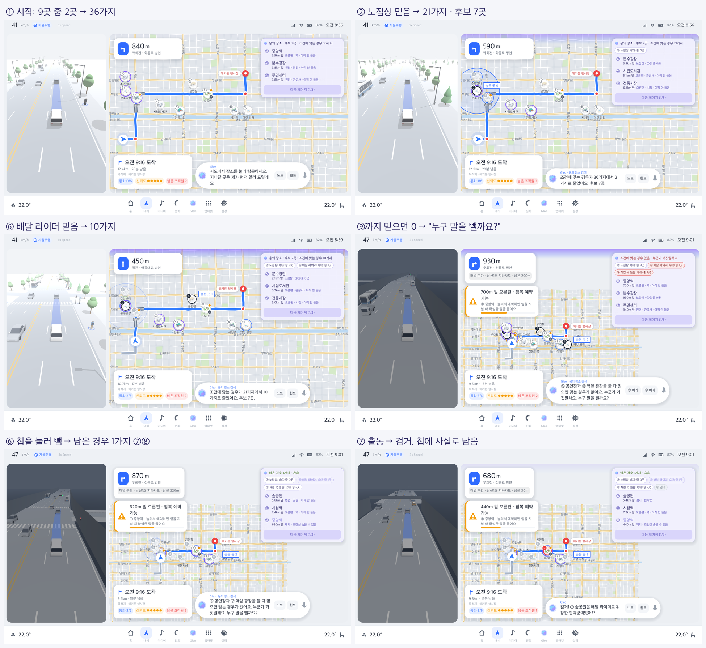

# 추려 나가는 재미: "용의 장소 검색" UX 설계안 (2026-10-20)

> **구현했다(2026-10-21).** 아래 "구현 메모"와 [스토리보드](images/deduction/storyboard.png)를 보라.
> 이후 몰입 연출(가짜 제보 설정, 회신 전화, 수사망 그물, 의심의 순간, 출동 절정, 결말 되짚기)을 얹었다: [story-bible.md](story-bible.md)

## 문제
- 지금 데모는 장소 9곳과 진술을 보여 주고 바로 출동·결과로 간다. 추리(누구 말을 믿을지, 그러면 어디가 빠지는지)는 전부 플레이어 머릿속에서 일어나고 화면에는 남지 않는다.
- 의심·무고 메모가 있긴 하지만 수동이고 진술과 연결돼 있지 않다.
- 그래서 "후보가 줄어든다", "내 추측이 어긋났다가 바로잡힌다"는 느낌이 없다.

## 참고한 UX

**검색 결과 카드(어두운 화면):**
- 지도 위쪽에 떠 있는 반투명 보라 카드다(오른쪽 목록 자리가 아니다).
- **한 번에 3줄**이다. 줄마다 작은 표시, 굵은 이름("강촌레일파크 김유정역"), 그 아래 굵은 거리("24.3km")와 회색 주소가 있다.
- 맨 아래는 꽉 찬 너비의 **[다음 페이지]**다.
- 결과 위치는 지도에 핀으로 보인다. Gleo가 말할 때는 화면 위쪽 가장자리가 빛난다.

**경로 옵션 카드(밝은 화면):**
- 목적지를 고르면 지도 왼쪽 위에 흰 카드가 뜬다.
- 경로 옵션 2개가 작은 카드로 쌓여 있다(굵은 시간, 작은 설명, 고른 것 표시).
- 맨 아래에 파란 **[경로 안내]**가 있다.

**흐름:** 음성 검색 → 결과 3개씩 [다음 페이지] → 하나 고르기 → 옵션 고르기 → 안내.

### 기사·다른 내비
- **Gleo(더 뉴 그랜저):**
  - 맛집을 3곳씩 음성과 화면으로 동시에 추천하고, "다음 보여줘"로 더 본다. ([디지털타임스](https://www.dt.co.kr/article/12077149))
  - 대화로 조건을 좁힌다(워터스포츠 → 워터 슬라이드 → 위치·가격). ([파이낸셜뉴스/뉴시스](https://www.fnnews.com/news/202605310900466074))
- **Google 지도 경로상 검색:** 경로를 벗어나지 않는 후보를 추가 소요 시간과 함께 보여 주고, 고르면 경유지로 넣는다. ([PopSci](https://www.popsci.com/?p=701541), [VentureBeat](https://venturebeat.com/technology/google-maps-now-helps-android-users-plan-pit-stops-and-find-the-cheapest-gas))
- **Gemini in Google 지도:** 대화를 이어 가며 조건을 붙이고("경로상, 비건, 2마일 안" → "주차는?" → "거기로 가자") 마지막에 목적지로 정한다. ([TechCrunch](https://techcrunch.com/2025/11/05/google-maps-bakes-in-gemini-to-improve-navigation-and-hands-free-use), [Google 블로그](https://blog.google/products/maps/gemini-navigation-global/))

공통 패턴: **검색어 → 후보 목록(개수) → 조건을 붙여 줄이기 → 상위 몇 개만 카드로, 나머지는 "다음" → 하나 골라 목적지 설정.**

## 결정 (2026-10-20, 사용자)
1. **용의 정도 표시: 경우의 수와 제외만.** 용의 %는 보여 주지 않는다. 어디가 유력한지는 플레이어가 판단한다.
2. **진술 칩 기본 상태: 믿음.** 들으면 바로 조건으로 걸린다. 말끼리 부딪혀 경우가 0이 되면 그때 "누구 말을 뺄까요?"로 판단을 묻는다.
3. **카드 모양: 실제 Gleo 카드에 그대로 맞춘다.** 지도 위쪽의 보라 카드, 3줄과 [다음 페이지], 고르면 경로 옵션 카드 모양의 행동 옵션 카드.

## 게임으로 옮기기: 사건 = 검색, 진술 = 조건, 출동 = 목적지 설정

| 내비 검색 | 게임 |
|---|---|
| 검색어 ("근처 맛집") | 사건 ("경로 주변 · 보이스피싱 조직원이 숨은 곳") |
| 결과 N곳 | 용의 장소 후보 N곳 + **조건에 맞는 경우 M가지**(숨은 곳 조합 수) |
| 대화로 붙이는 조건 | **진술 칩** ("② 노점상: ①③엔 없음"). 들으면 믿음, 누르면 못 믿음 |
| 거리순 3줄 + [다음 페이지] | **지나가는 순서(가까운 앞쪽부터) 3줄** + [다음 페이지]. 빠진 곳은 맨 뒤 페이지에 줄을 그어 둔다 |
| 경로 옵션 카드 → [경로 안내] | **행동 옵션 카드**(탐문 / 잠복 예약 / 경유지 잠복) → [실행], 따로 [출동] |
| 조건이 너무 많아 결과 0 | **믿는 말끼리 부딪힘 → "누군가 거짓말해요. 누구 말을 뺄까요?"** |
| 고른 곳으로 안내 | **출동** (남은 경우가 하나면 Gleo가 출동을 권한다) |

핵심은 플레이어가 고르는 것이 "장소"가 아니라 **"누구 말을 믿을지"**라는 점이다. 화면은 그 선택의 결과(남은 경우의 수, 빠지는 장소)를 바로 보여 준다. 추측이 어긋나면 경우가 0이 되고, 말 하나를 빼면 다시 살아난다.

## 화면 규격 (Gleo 카드에 맞춤)

### 1. 용의 장소 검색 카드 (지도 위쪽 가운데, 반투명 보라 Gleo 카드)
- **머리줄(작게):** "용의 장소 · 후보 6곳 · 조건에 맞는 경우 10가지"
  - 0이면 빨강: "조건에 맞는 경우 없음 · 누군가 거짓말해요"
  - 1이면 초록: "남은 경우 1가지 · ⑦⑧"
- **조건 칩 줄:** 들은 진술이 칩으로 붙는다. 최대 2줄이고, 넘치면 앞쪽은 "+3"으로 접는다.
  - 믿음(채움), 못 믿음(줄 긋기), ★잠복(잠김, 주황), 신분 주장(판단 보류, 회색)
  - 칩을 한 번 누르면 믿음 ↔ 못 믿음이 바뀐다.
- **결과 3줄:** 남은 후보를 지나가는 순서로 보여 준다.
  - 줄마다 번호 표시(①…), 굵은 장소 이름, 그 아래 굵은 거리("1.2km 앞")와 회색 설명("오른편 · 광장 · 아직 안 들음" / "노점상 · ①③엔 없음")을 둔다. Gleo 카드의 "거리 + 주소" 형식이다.
  - 빠진 곳은 남은 후보 다음 페이지들에 회색 줄 긋기와 "제외 · ②의 말"로 보여 준다.
- **[다음 페이지]:** 꽉 찬 너비 버튼으로 다음 3곳을 보여 준다. 음성은 "다음 보여줘"다.
- **지도:**
  - 지금 카드에 보이는 3곳의 핀은 번호 표시와 함께 밝게 한다.
  - 제외된 곳은 회색으로 작아진다. 나머지 후보는 보통이다.
  - Gleo가 말할 때 지도 위쪽 가장자리가 보라·파랑으로 빛난다.

### 2. 행동 옵션 카드 (줄을 고르면 지도 왼쪽 위, 흰 카드)
- 맨 위에 장소 이름, 업종, 거리, 들은 말이 있으면 한 줄로 둔다.
- 옵션을 작은 카드로 쌓고, 하나를 고른다(경로 옵션처럼 굵은 값 + 작은 설명).
  - **탐문** — "통화 1번" · 남은 통화 4번
  - **잠복 예약** — "지날 때 · 무료" · 길가 장소, 잠복 창 안일 때만
  - **경유지 잠복** — "+2분 · 통화 1번" · ⑦ 잠복 사라짐
- 맨 아래 파란 버튼으로 고른 옵션을 실행한다([탐문하기] / [예약하기] / [경로 바꾸기]). 그 옆에 [출동](빨강, 두 번 눌러 확인)을 둔다.
- 경로 옵션 카드처럼 고르기 → 확정 두 단계라, 경유지의 "한 번 더 누르면" 확인이 자연스럽게 들어간다.

### 3. Gleo 말
- 진술을 들으면 대사를 말하고 "조건에 맞는 경우 21가지로 줄었어요"를 덧붙인다.
- 0이 되면 "⑥과 ⑨를 둘 다 믿으면 맞는 경우가 없어요. 누구 말을 뺄까요?"라고 묻고 [⑥ 빼기] [⑨ 빼기]를 띄운다.
- 1이 되면 "⑦ 숲공원과 ⑧ 시청역만 남았어요. 출동할까요?"라고 권한다.
- 음성 명령 예: "② 말은 못 믿겠어", "후보 보여줘", "다음 보여줘", "⑦ 고를게", "⑦로 출동해".

### 지금 화면에서 바뀌는 것
- **오른쪽 장소 목록(사건 장소 · 지나가는 순서):** 용의 장소 검색 카드로 대신한다. 오른쪽 열은 비워 지도를 넓히거나, 수사 노트만 둔다.
- **장소 카드(POI 카드):** 행동 옵션 카드로 바꾼다.
- **의심·무고 메모:** 진술 칩의 믿음/못 믿음이 대신한다. 메모는 노트에만 남긴다.

### 데모 사건에 대입하면 (phishing-1000, 실제 진술)
| 단계 | 믿는 말 | 조건에 맞는 경우 | 후보 |
|---|---|---|---|
| 시작 | — | 36 | 9곳 |
| ② 노점상 탐문 | ①③ 중 0곳 | 21 | 7곳 |
| ⑥ 배달 라이더 탐문 | 광장 ②⑨ 중 1곳 | 10 | 7곳 |
| ⑨ 탐문(터널, 직업 못 들음) | ⑦⑧ 중 2곳 | **0 → 부딪힘** | (빼지 않음) |
| ⑥ 말을 뺀다 | ②, ⑨ | **1 → ⑦⑧** | 2곳 |
| ⑦·⑧ 출동 | 검거 2 | 해결 | — |

의심 → 충돌 → 한 명 빼기 → 확신 → 출동으로 이어지는 흐름이 한 판 안에 실제로 나온다. 위 표는 실제 팩 데이터로 셌고 `test_case_flow.gd`가 같은 숫자를 확인한다.
- 부딪혔을 때 [힌트](신뢰도 -1)를 쓰면 "⑥ 공연장의 말은 믿지 않는 게 좋겠어요"라고 짚는다.
- 처음 설계안에는 "⑥ 경유지 잠복으로 확인"이 있었다. 하지만 이미 탐문한 곳은 잠복할 수 없는 규칙(Python과 같음)이라 뺐다. 경유지 잠복은 아직 안 들은 곳에만 쓴다.

## 구현 메모 (2026-10-21)



- **오른쪽 위 한 자리를 세 카드가 나눠 쓴다.** 우선순위는 사건 카드(제안·브리핑·노트) > 행동 옵션 카드(장소를 골랐을 때) > 용의 장소 검색 카드(기본)다. Gleo 화면 흐름(결과 → 고르기 → 옵션)과 같다. 사건 모드에서는 오른쪽 장소 목록과 예전 장소 카드를 쓰지 않는다.
  - 처음 안은 "지도 위쪽 가운데"였지만, TBT 카드·잠복 경고와 겹치지 않게 오른쪽 위 자리에 띄웠다.
- **검색 카드:**
  - 머리줄 색은 보통(보라), 0가지(빨강), 1가지(초록)다.
  - 칩은 최대 6개다. 넘치면 앞쪽을 "+N · 노트"로 접고, 누르면 수사 노트가 열린다.
  - 칩 종류는 믿음(채움), 못 믿음(줄 긋기), ★잠복(잠김), ?위장 주장(판단 보류), 출동 결과(사실)다.
  - 0가지가 되면 하나만 빼면 풀리는 칩에 빨간 테두리를 두르고, 지도·목록에서는 아무 곳도 빼지 않는다.
- **행동 옵션 카드:** 옵션마다 값("통화 1번", "지날 때 · 무료", "+2분 · 통화 1번")과 못 쓰는 까닭을 보여 준다. 기본 선택은 쓸 수 있는 첫 옵션이다. 출동 결과가 나오면 검색 카드로 돌아간다.
- **Gleo 안내:**
  - 경우의 수가 바뀌면 Gleo가 말한다.
  - 진술을 들은 직후라면 진술을 6초 보여 준 다음, 줄 맨 앞에 끼어들어 말한다. 주행 안내에 밀려 버려지지 않는다.
  - 0가지면 [⑥ 빼기] [⑨ 빼기], 1가지면 [⑦ 보기] [⑧ 보기] 버튼을 함께 띄운다.
  - Gleo가 말할 때마다 지도 위쪽 가장자리가 보라·파랑으로 잠깐 빛난다.
- **힌트:** 믿는 말 중 거짓 하나, 없으면 뺀 말 중 참 하나를 짚는다. 둘 다 없으면 "모두 맞게 골랐어요"라고 답하고, 이때도 신뢰도를 쓴다. 공짜면 칩을 바꿔 가며 정답을 맞춰 볼 수 있기 때문이다.
- **자동 실행:** `xN`(칩 믿음 ↔ 못 믿음), `pg`(다음 페이지), `cl`(행동 카드 닫기). 스토리보드는 아래 명령으로 찍었다.
  ```bash
  godot --path godot -- --shotdir=/tmp/deduce --autoplay="w2,offer,accept,start,w1.5,shot=d01,t2,w1.5,shot=d02,cl,w5.2,shot=d03,ff0.12,t6,cl,w6.6,shot=d04,totunnel,t9,cl,w6.6,shot=d05,x6,w1.6,shot=d06,sel7,w1,shot=d07,r7,w3.5,shot=d08,r8,w4,shot=d09"
  ```

## 엔진·규칙 영향
- **Godot에 작은 판정기를 둔다.**
  - 숨은 곳 조합은 C(9,2)=36 또는 C(9,3)=84개뿐이다.
  - 믿는 칩마다 조건을 걸러 남은 조합을 센다. 개수 단서는 `members` 중 `count`곳이고, 보증(VOUCH)은 숨음/안 숨음이다.
  - 후보는 남은 조합 중 한 번이라도 숨은 곳으로 나오는 장소다. 매번 1ms 안쪽이다.
- **신분 주장(REVEAL)과 고발(VOUCH 수상):** 위장했다고 해도 조직원이 아니라 취객일 수 있다. 그래서 판단 보류 칩으로 둔다(조합을 자르지 않고 장소 줄에 "위장 주장" 표시만).
  - 진짜(genuine) 주장은 조직원은 늘 위장하므로 "숨은 곳 아님"으로 쓸 수 있다.
- **힌트를 다시 정한다.** 플레이어가 경우 0으로 스스로 충돌을 찾는다. 그래서 힌트는 "부딪히는 둘 중 어느 쪽이 더 수상한지 짚기"(신뢰도 -1)로 바꾼다.
- **Python 통계:** 규칙(진실·거짓 구조)은 그대로라 봇 통계는 바뀌지 않는다. 화면 보조 기능이다.
