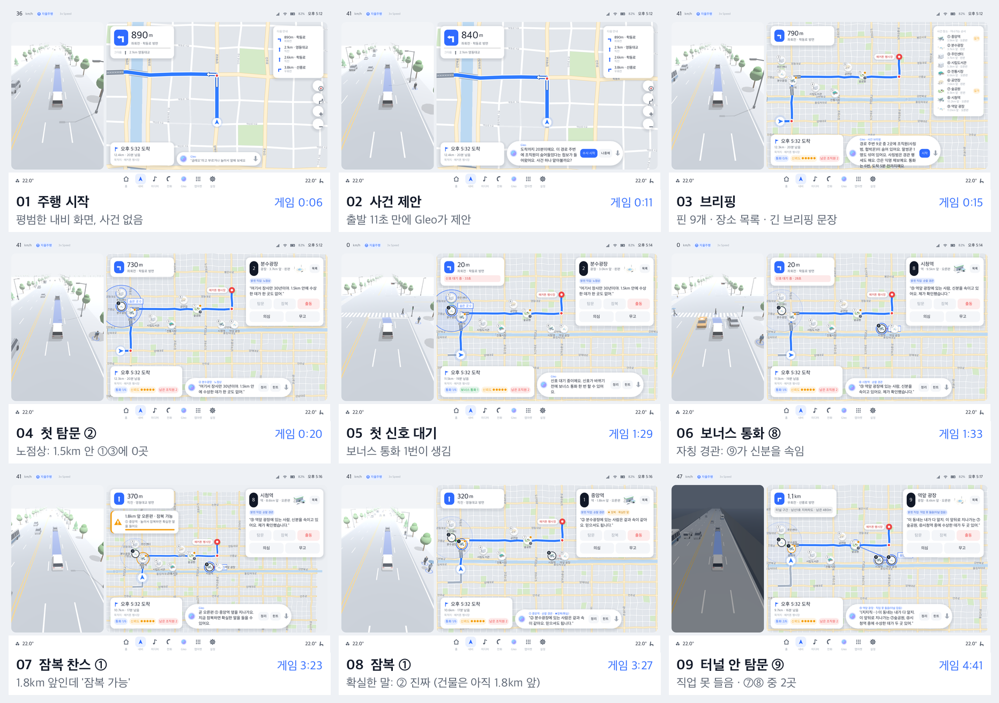
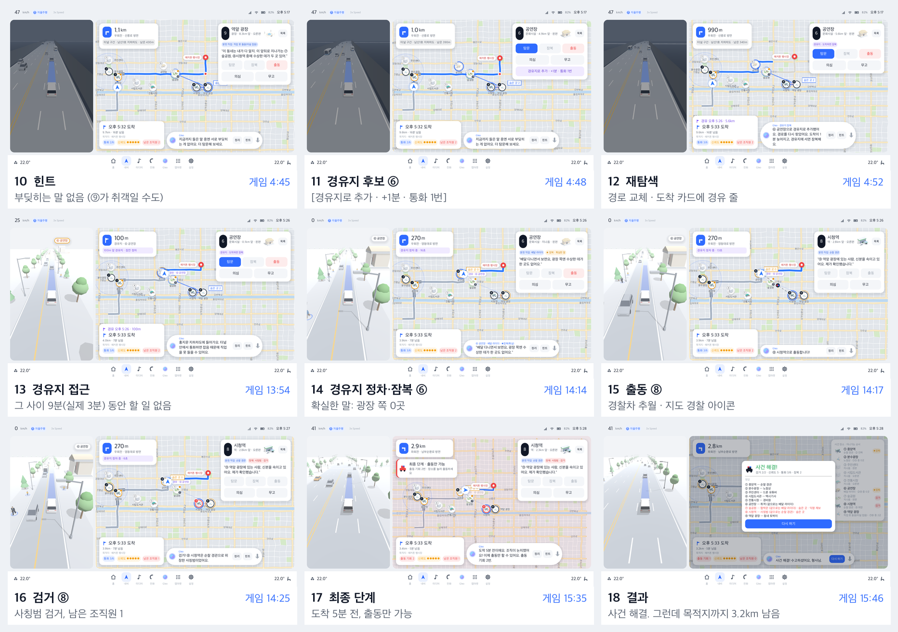
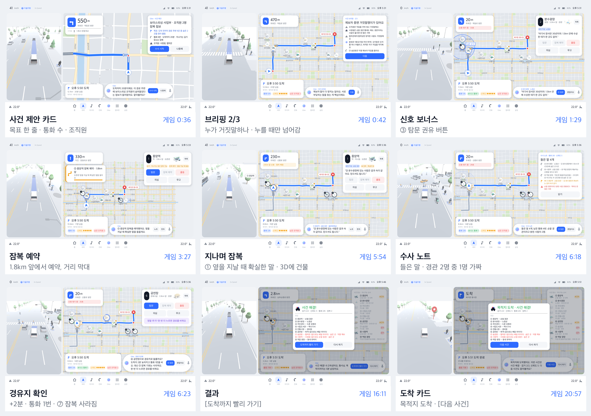

# 한 판 시뮬레이션 점검 (2026-10-20)

데모 사건(보이스피싱 사업부, `phishing-1000`)을 처음부터 끝까지 자동 실행으로 돌리며 화면 18장을 찍었다.

- 시각은 **게임 시간**이다. 3배속이면 실제 시간은 1/3이다.
- 다시 찍으려면 아래 명령을 쓴다.
  ```bash
  godot --path godot -- --shotdir=/tmp/story --autoplay="w2,shot=01,offer,w1.5,shot=02,accept,w1.2,shot=03,start,t2,w1.2,shot=04,tostop,w1,shot=05,t8,w1.2,shot=06,nextstake,w1,shot=07,s,w1.2,shot=08,totunnel,t9,w1.2,shot=09,h,w1,shot=10,sel6,w1,shot=11,wp6,w1,shot=12,nearwp,w1,shot=13,towp,w1.2,shot=14,r8,w1,shot=15,w2.5,shot=16,final,w1.2,shot=17,r7,w3.5,shot=18"
  ```




## 흐름 (이번 실행)

| 게임 시각 | 3배속 실제 | 화면 | 플레이어 |
|---|---|---|---|
| 0:06 | 2초 | 평범한 주행 | — |
| 0:11 | 4초 | Gleo 사건 제안 | 수사 시작 |
| 0:15 | 5초 | 브리핑: 핀 9개, 장소 목록, 긴 브리핑 문장 | 시작 |
| 0:20 | 7초 | ② 탐문: "1.5km 안 0곳" + 반경 원 | — |
| 1:29 | 30초 | 첫 신호 대기 → 보너스 통화 1번 | ⑧ 탐문(자칭 경관: "⑨ 신분 속임") |
| 3:23 | 68초 | ① 잠복 찬스("1.8km 앞 · 잠복 가능") | 잠복 → "② 진짜" |
| 4:41 | 94초 | 지하차도 안 ⑨ 탐문 → 직업 못 들음, "⑦⑧ 중 2곳" | 힌트 → "부딪히는 말 없음" |
| 4:52 | 97초 | ⑥ 경유지 추가(+1분) → 재탐색 | — |
| 4:52~13:54 | 97~278초 | 두 번째 신호·지하차도만 지나감 | (할 일 없음) |
| 14:14 | 285초 | ⑥ 경유지 정차·잠복 → "광장 쪽 0곳" | ⑧ 출동 → 검거 |
| 15:35 | 312초 | 최종 단계(도착 5분 전) | ⑦ 출동 → 승리 |
| 15:46 | 315초 | 결과 카드 | 목적지까지 3.2km 더 달림 |

## 발견한 문제 (중요한 순)

1. **인입이 급하고 무엇을 하는 게임인지 안 보인다.**
   - 출발 11초 만에 제안이 뜨고, 수락하면 한 문단짜리 브리핑이 나온다(조직원 2종, 말썽꾼, 사칭, 익명, 통화 6번). 9초 뒤에는 자동으로 시작한다.
   - 목표("숨은 2곳을 찾아 출동")와 할 일(장소를 눌러 탐문 → 길가는 잠복 → 출동)이 화면에 정리돼 있지 않다.
2. **잠복이 "지나가며"가 아니다.**
   - 길가 장소 1.8km 앞에서 "잠복 가능"이 뜨고, 누르면 바로 확실한 말을 듣는다. 그때 주행 화면에는 그 건물이 없다.
   - 잠복 창은 처음 경로 진행률의 −0.15~+0.03이다.
3. **사건이 앞쪽에 몰리고 가운데가 빈다.**
   - 제안·탐문·신호 보너스·잠복·지하차도가 처음 실제 1분 반 안에 다 나온다.
   - 그 뒤 실제 3분가량 Gleo가 먼저 말을 거는 일이 없다. 신호 보너스는 판당 1번이라 두 번째 신호는 그냥 지나간다.
4. **경유지 재탐색이 길가 잠복 기회를 말없이 없앤다.**
   - ⑥을 경유지로 넣자 새 경로가 ⑦ 옆(52m → 723m)을 안 지나가, ⑦ 잠복 찬스가 알림 없이 사라졌다.
   - 경유지 비용도 +1분(정차 20초)뿐이라 통화 1번 말고는 대가가 거의 없다.
5. **사건이 끝나도 차는 5분 더 간다.** 결과 카드가 도착 5분 전에 뜨고, 나머지는 그냥 주행이다. 데모 마무리가 어색하다.
6. **진술이 금방 덮인다.** Gleo 바 한 줄에 진술과 시스템 안내가 번갈아 써서, 직전 진술이 곧 사라진다. 진술은 장소 카드와 목록 부제에만 남는다.
7. **힌트가 직관과 다를 수 있다.**
   - ⑧ "⑨ 신분 속임"과 ⑨ "⑦⑧ 중 2곳"은 부딪혀 보인다. 하지만 ⑨가 취객이면 둘 다 참일 수 있어 "부딪히는 말 없음"이 나온다.
   - 규칙상으로는 맞지만, 처음 하는 사람에게는 헷갈린다.
8. **길이:** 3배속으로 한 판이 실제 5~7분이다. 3~4분 라이브 데모에는 길다. 10배속이면 2분이지만 대사를 읽을 틈이 없다.

## 반영 결과 (2026-10-20)

아래 6가지를 모두 반영하고, 같은 판을 다시 돌려 확인했다.



| 문제 | 바꾼 것 |
|---|---|
| 인입 | 제안은 출발 35초(게임) 뒤에 사건 카드로 뜬다(목표 한 줄, 통화 수, 조직원). 브리핑은 카드 3장(목표 / 누가 거짓말하나 / 할 수 있는 것)이고, 누를 때만 넘어간다 |
| 잠복 | 길가 장소는 잠복 창(1.8km 앞~)에서 **예약**만 받는다. 확실한 말은 그 장소 옆(30m 앞)을 지날 때 나오고, 주행 화면에 건물이 보인다. 경고 카드는 "① 잠복 예약 · 890m 앞"으로 남은 거리를 보여 준다 |
| 가운데 | 150~750m 앞의 안 들은 장소를 Gleo가 먼저 권한다([③ 탐문] 버튼, 45초 간격). 100초 동안 아무것도 안 하면 가까운 곳을 권한다. 도착 12·8분 전에 남은 통화를 알린다. 신호 보너스는 판당 2번이고, 권할 장소 버튼이 함께 뜬다 |
| 경유지 | 첫 누름에 "+N분 · 통화 1번 · ⑦ 잠복 사라짐"을 알리고, 한 번 더 눌러야 경로를 바꾼다. 경유지 정차는 45초(대가). 경로가 바뀌어 못 하게 된 예약은 취소 안내 |
| 마무리 | 결과 카드에 [도착까지 빨리 가기](10배속). 도착하면 "목적지 도착 · 사건 해결" 카드와 [다음 사건](팩의 다음 사건으로 다시 시작) |
| 진술 기록 | Gleo [노트] → 수사 노트 카드(들은 말, 같은 직업 중복, 힌트, 출동 결과, 메모). Gleo 바에서 진술은 6초 동안 다른 안내로 덮지 않고, 안내는 줄을 섰다가(8초 지나면 버림) 나온다 |

검증: `test_case_flow.gd` 63개 확인(제안 카드·브리핑 3장, 잠복 예약 → 지날 때 진술, 권유, 노트, 빨리 가기 → 도착 카드). 다른 테스트도 그대로 통과한다.

## 고칠 방향 (제안, 반영 전 기록)

- **인입:**
  - 제안은 출발 30~40초 뒤나 발표자 키로 띄운다.
  - 제안 카드에 한 줄 목표를 넣는다.
  - 브리핑은 카드 3장으로 나누고(목표 / 누가 거짓말하나 / 할 수 있는 것), 누를 때만 넘어간다.
- **잠복 = 예약 + 지나갈 때 진술:** 1.8km 앞에서는 "잠복 예약"만 받고, 확실한 말은 그 건물 옆을 지날 때(주행 화면에 건물이 보일 때) 나오게 한다. 경유지 잠복과 같은 모양이 된다.
- **가운데 채우기:**
  - 안 들은 장소에 다가가면 Gleo가 먼저 권한다("곧 ③ 근처예요, 통화해 볼까요?").
  - 신호마다 짧은 보너스를 주거나, 남은 시간·통화를 상기시킨다.
- **경유지:**
  - 추가할 때 사라지는 잠복 기회를 미리 알린다("⑦ 잠복 기회는 사라져요").
  - 정차를 길게 하거나 최종 단계를 앞당겨 대가를 키운다.
- **마무리:** 사건이 끝나면 데모 모드에서는 도착 장면으로 빨리 감고, 도착 카드 안에 결과와 다음 사건(런)을 보여 준다.
- **진술 기록:** 들은 진술을 쌓아 보는 "수사 노트"(Gleo [정리] 또는 목록 펼침)를 두고, 시스템 안내가 진술을 덮지 않게 한다.
