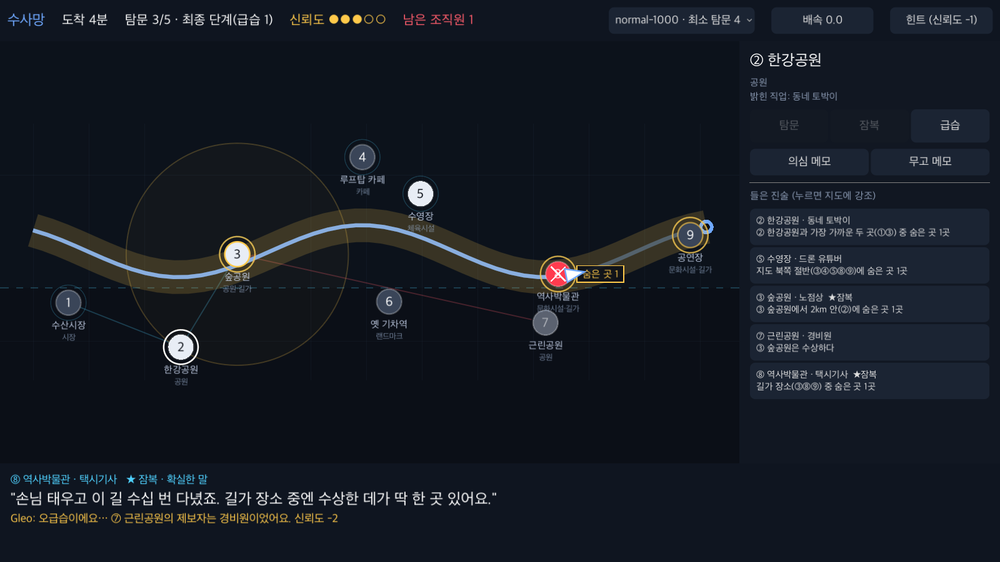
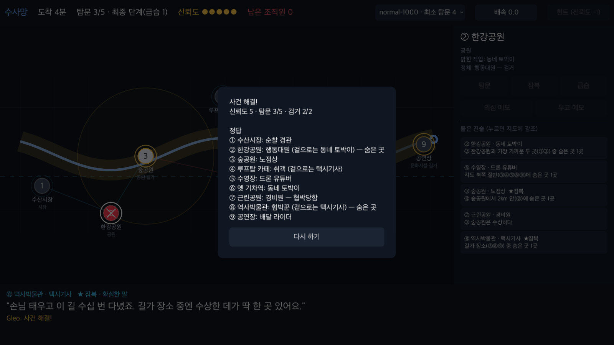

# 퍼즐 엔진 프로토타입 결과 (2026-10-20)

> 대상: [concept-v0](concept-v0.md)의 공통 규칙. 역할 12개, 단서 7종, 잠복, 오염, 쉬움·보통·어려움.
> 사업부 고유 규칙(사칭, 베팅, 화물 이동)은 아직 넣지 않았다.
> 코드: [prototype/](../prototype/README.md) (Python 퍼즐 공장), [godot/](../godot/README.md) (Godot 데모 골격)

## 1. 결론

- **풀 만한가: 예.**
  - 생성한 퍼즐은 모두 9곳을 다 탐문하면 답이 하나로 정해진다. 답이 하나인 퍼즐은 평균 1.0~1.3번 시도면 나온다.
  - 모든 경우를 대입하는 봇은 기본 예산과 잠복으로 **보통 80%, 어려움 84%를 찍기 없이** 풀었다.
- **재미있는가: 직접 해 본 두 판에서는 "아하" 순간이 실제로 나왔다.**
  - 보통: 오지랖 보정 → 경관 확인 → 잠복 확정 → 소거로 이어지는 추리.
  - 어려움: "드론 유튜버가 3명 → 행동대원은 1명뿐 → 그 직업은 판에 없다 → 셋 다 가짜"라는 추리.
  - 다만 어려움은 위장 규칙을 완전히 알아야 풀린다.
- **가장 큰 발견: 잠복 찬스는 보너스가 아니라 핵심 장치다.**
  - 잠복이 없으면 보통 난이도의 찍기 없는 해결이 80% → 26%로 떨어진다.
  - "실제로 달리는 길이 게임 정보가 된다"는 컨셉이 수치로도 확인됐다.
- **한계:** 봇은 수천 가지 경우를 다 대입하는 완벽한 논리가다. 사람의 체감 난이도는 이 수치보다 높으므로, 사람 대상 플레이테스트가 필요하다.

### 프로토타입 중 바꾼 규칙
- **장소 최소 간격 400m → 700m, 보스 오염 반경 500m → 1km.**
  - Godot 화면에 경로 전체(약 11km)를 담으면 400m가 44px 정도라 핀이 겹쳤다.
  - 간격을 넓히면 500m 안에 장소가 거의 없어서 보스 반경도 같이 늘렸다.
- 아래 통계는 바뀐 규칙 기준이다.
- 3절의 직접 플레이 기록은 바뀌기 전 규칙(400m, 500m)으로 한 것이라 같은 seed라도 지금은 다른 보드가 나온다.

## 룰 v1(내비 Dupery) 결과 — 최신
[demo-plan.md](demo-plan.md) 3절의 규칙 변경을 엔진에 반영한 뒤 다시 낸 통계다. 아래 2절 이후는 v0 기준 기록이다.

**바뀐 규칙**
- 단서 HALF와 NEAR를 SPAN(경로 구간), SIDE(경로 왼편/오른편), NEIGHBOR(지나가는 순서상 앞뒤)로 바꿨다.
- 통화(탐문) 한 번에 이동 시간이 흐른다.
- 잠복은 지나치면 사라진다.
- 보이스피싱 사업부를 추가했다: 사칭범(경관 행세)과 익명 제보.

| 난이도 | 통화 수 | 찍기 없이 해결 (smart + 잠복) | 잠복 없음 (조정 전 통화 수) | 평균 헛걸음 | 평균 잠복 | 최소 탐문 평균 |
|---|---|---|---|---|---|---|
| 쉬움 | 5 | 90% | 64% | 0.05 | 1.38 | 2.73 |
| 보통 | 5 | 76% | 32% | 0.14 | 1.50 | 3.62 |
| 어려움 | 6 → **7** | 78% → **90%** | 31% | 0.12 | 1.49 | 4.59 |
| 보이스피싱 | 5 → **6** | 68% → **84%** | 22% | 0.23 | 1.59 | 3.90 |

- **통화 수 조정:** 보이스피싱은 사칭과 익명 제보 때문에 정보가 줄어서, 통화 5번이면 목표(75%)에 못 미쳤다. 6번으로 올렸다. 어려움은 7번으로 올렸다.
  - 보통: 4번 56%, 5번 76%, 6번 88%
  - 보이스피싱: 5번 68%, 6번 84%, 7번 94%
  - 어려움: 6번 78%, 7번 90%
- **잠복 기회:** 지나치면 사라지게 바꾸면서 평균 잠복 횟수가 약 1.7회에서 1.4~1.6회로 줄었다. 사람은 봇보다 더 자주 놓칠 것이라, 잠복 경고 카드를 눈에 잘 띄게 하는 게 중요하다.
- **보이스피싱 데모 사건:** 경관이라고 밝힌 사람이 반드시 두 명 나온다. "둘 중 하나는 사칭범"이 첫 추리 고리가 된다.

## 2. 대량 통계 (난이도별 200개)

- 봇 종류:
  - smart: 확실한 곳은 바로 급습하고, 애매하거나 깨끗해 보이는 곳부터 탐문한다.
  - random: 탐문할 곳을 무작위로 고른다.
- 모든 봇이 정보가 확정될 때까지는 급습하지 않고, 예산이 끝나면 가장 의심스러운 곳부터 찍는다.

| 지표 | 쉬움 | 보통 | 어려움 |
|---|---|---|---|
| 구성 | 행동대원 2 | 행동대원 + 협박꾼, 말썽꾼 1 | 행동대원 + 협박꾼 + 보스, 말썽꾼 1 |
| 탐문 예산 | 5 | 5 | 6 |
| 최소 탐문 수 평균 (잠복 없이 / 잠복 활용) | 2.71 / 2.67 | 3.73 / 3.41 | 4.87 / 4.30 |
| 최소 탐문 2회 이하로 풀림 (너무 쉬움) | 39% | 4% | 4% |
| 최소 탐문 수가 예산 이하 | 100% | 100% | 91% |
| 거짓말을 간파해야 풀린 판 (smart 봇이 들은 말을 다 믿으면 모순) | 68% | 70% | 81% |
| **찍기 없이 해결: smart + 잠복** | **96%** | **80%** | **84%** |
| 찍기 없이 해결: smart, 잠복 없음 | 68% | 26% | 34% |
| 찍기 없이 해결: random + 잠복 | 88% | 73% | 77% |
| 평균 오급습 (smart + 잠복) | 0.01 | 0.12 | 0.08 |
| 평균 탐문 / 잠복 (smart + 잠복) | 3.22 / 1.56 | 3.98 / 1.71 | 4.71 / 1.73 |

- 기본 예산에서 신뢰도 0으로 해임된 판은 잠복 없는 smart 봇의 보통 1판(0.5%)뿐이었다.
- smart와 random의 차이가 작다. 어디부터 탐문하느냐보다 **들은 말을 어떻게 맞춰 보느냐**가 승부를 가른다. 사람에게는 정리 화면과 힌트가 중요하다는 뜻이다.

### 탐문 예산에 따른 변화 (찍기 없이 해결 비율, smart 봇)
| 예산 | 쉬움 잠복O | 쉬움 잠복X | 보통 잠복O | 보통 잠복X | 어려움 잠복O | 어려움 잠복X |
|---|---|---|---|---|---|---|
| 3 | 68% | 16% | 41% | 0% | 23% | 1% |
| 4 | 86% | 39% | 60% | 8% | 50% | 5% |
| 5 | 96% | 68% | 80% | 26% | 66% | 15% |
| 6 | 98% | 90% | 90% | 60% | 84% | 34% |
| 7 | 99% | 97% | 96% | 82% | 94% | 64% |

잠복이 없으면 예산 4 이하에서 해임(신뢰도 0)이 나오기 시작했다.
- 보통: 예산 3은 24%, 예산 4는 7%
- 어려움: 예산 3은 29%, 예산 4는 10%

## 3. 직접 플레이 기록 (바뀌기 전 규칙)

### 보통 (seed 101): 탐문 2 + 잠복 2로 해결, 오급습 0
1. **①탐문, 오지랖 주민:** "2km 안(②)에 1곳". 실제로는 1을 빼야 하니 ②는 깨끗하다. 말썽꾼이 오지랖이라는 게 드러났으니 취객은 없다.
2. **③탐문, 배달 라이더:** "관공서(③⑤) 중 1곳".
3. **④잠복, 순찰 경관:** "⑥은 신분을 속이고 있다". 취객이 없으니 ⑥은 숨은 곳이다.
4. **⑥잠복, 택시기사:** "길가(④⑥⑨) 중 1곳". 그 한 곳이 ⑥이므로 ④⑨는 깨끗하다.
5. **③이 숨은 곳이라고 가정하면 모순:** 숨은 곳이 ③⑥이면 ③의 말이 참이 되는데, 조직원은 거짓말을 해야 한다. 따라서 ③은 선하다. ③은 협박 범위에서도 멀다. 그러니 ⑤가 숨은 곳이다.
6. **결과:** ⑥, ⑤ 급습 → 협박꾼과 행동대원 검거.

느낌: 짧고 깔끔하다. 단서마다 역할이 분명해서 연쇄 추리가 기분 좋다.

### 어려움 (seed 202): 탐문 6 + 잠복 1로 해결, 오급습 0
- **진행 중 실수:** 길가 장소(②⑤)를 일반 탐문해서 공짜 잠복 기회를 날렸다.
- **결정적 추리:**
  1. ⑨ 잠복(확실): "북쪽 절반에 1곳" → 남쪽에 2곳.
  2. ④, ⑧, ⑨ 세 명이 모두 드론 유튜버라고 밝혔다.
  3. 드론 유튜버가 판에 있다면, 가짜 둘이 '판에 있는 직업'으로 위장해야 하는데 그건 행동대원만 가능하고 행동대원은 1명뿐이다.
  4. 따라서 드론 유튜버는 판에 없고, ④⑧⑨는 협박꾼, 보스, 취객이다.
  5. 여기에 북/남 개수를 맞추면 ⑧ 확정 → ④ → 남은 남쪽의 행동대원 ⑥.
- **결과:** ⑧, ④, ⑥ 모두 검거.

느낌: 가장 재미있는 순간이었다. 하지만 위장 규칙(행동대원은 판에 있는 직업, 나머지는 판에 없는 직업)을 정확히 알아야 하고, 음성 브리핑만으로는 이해하기 어렵다.

## 4. 설계에 반영할 제안

| # | 발견 | 제안 |
|---|---|---|
| 1 | 잠복이 해결률을 크게 좌우한다 | 보드 생성에서 길가 장소 2~3곳을 필수 조건으로 둔다(현재 구현됨). 길가 장소가 없는 경로(고속도로 등)는 탐문 예산 +2 |
| 2 | 예산 공식이 난이도와 무관하다 | **난이도별 기본 예산 + ETA 보정**으로 바꾼다. 기본값은 쉬움 4, 보통 5~6, 어려움 7. ETA가 짧으면 -1, 길면 +1 |
| 3 | 쉬움의 39%는 탐문 2번이면 풀린다 | 튜토리얼에는 적당하다. 일반 판에서는 최소 탐문 수 3 이상인 퍼즐만 채택한다(생성기에 조건 추가 가능) |
| 4 | 어려움은 규칙 지식에 크게 의존한다 | 런의 티어 해금에 맞춰 규칙을 하나씩 연다. 1티어는 행동대원과 오지랖, 2티어는 협박꾼과 취객, 3티어는 보스 |
| 5 | 길가 장소를 일반 탐문하면 손해 | Gleo가 한 번 막는다: "곧 지나갈 곳이에요. 잠복하면 공짜고 확실해요." (Godot 골격에 구현됨) |
| 6 | 오지랖 주민은 정체가 바로 드러나 긴장감이 없다 | v1에서 다른 직업으로 보이는 변형을 검토한다 |
| 7 | 협박 범위(가장 가까운 사람, 보스 1km) 추론에 거리 감각이 필요하다 | 핀을 누르면 거리 링이나 "가장 가까운 곳" 연결선을 보여주는 보조 UI |
| 8 | 정직 직업이 7개뿐이라 용의 목록이 항상 전부다 | 직업을 늘리면 Dupery식 용의 목록이 의미를 갖는다(v1) |
| 9 | "같은 직업 여러 명" 추리가 가장 재미있다 | 정리 화면과 Gleo 요약에서 중복 직업을 항상 짚어준다(CLI, Godot 모두 구현됨) |

## 5. Godot 데모 연동

### 구조: Python 퍼즐 공장 → JSON 퍼즐 팩 → Godot
- **Python:** 생성, 검증, 통계를 맡는다. 검증을 통과한 퍼즐만 JSON으로 내보낸다.
- **Godot:** JSON을 읽어 지도, 단서 도형, 연출, 음성만 맡는다.
  - 힌트용 모순 쌍과 단서 도형의 대상 장소는 미리 계산해 넣었다. 그래서 **Godot 쪽에 솔버가 필요 없다.**
  - 데모 중에 퍼즐 생성 버그가 날 위험이 없다.
- **형식:** [puzzle-pack-schema.md](puzzle-pack-schema.md)
- **Godot 규칙 구현:** [godot/scripts/puzzle_case.gd](../godot/scripts/puzzle_case.gd)
  - Godot 4.7.2 헤드리스 테스트로 검증했다. 사건 18개, 확인 509개 모두 통과.
- **데모 골격:** [godot/README.md](../godot/README.md)

| 플레이 중 | 사건 해결 |
|---|---|
|  |  |

### Godot에서 고려할 점
| 항목 | 권장 / 현재 상태 |
|---|---|
| 언어 | GDScript. Android 내보내기가 가장 무난하다 |
| 렌더러 | Compatibility(OpenGL ES 3). 차량용 칩과 에뮬레이터 호환성을 우선한다(골격에 적용됨) |
| 화면 | 가로 고정. 기준 해상도 1920×1080, stretch expand라 1920×720 같은 와이드 화면에도 맞는다 |
| 한글 폰트 | SystemFont(Apple SD Gothic Neo, Noto Sans CJK KR 등) 대체 목록을 쓴다. 기기에 한글 폰트가 없으면 Noto Sans KR(OFL)을 프로젝트에 넣는다 |
| 지도 | Godot에는 지도 SDK가 없다. 지금은 경로, 장소, 단서 도형만 직접 그린다. 배경 도로는 OSM에서 미리 뽑은 선 데이터나 정적 지도 이미지를 깔면 된다(출처 표기) |
| 3D 에셋 | Blender → glTF(.glb) → Godot 4 기본 임포트. 지금의 2D 핀 자리에 3D 핀을 올리면 된다 |
| TTS | `DisplayServer.tts_speak`(OS 음성 합성)로 대사를 읽는다. 한국어 음성이 있을 때만 켜진다 |
| 음성 인식 | Godot에는 내장 기능이 없다. Android 플러그인(SpeechRecognizer)이나 클라우드 STT를 HTTPRequest로 붙인다. 데모 안정성을 위해 화면 버튼도 같이 둔다 |
| LLM 대사 | HTTPRequest로 호출한다. 입력은 `statements[].clue` + 캐릭터 설정이다. 실패하거나 느리면 `line` 템플릿을 그대로 TTS로 읽는다 |
| 차량 데이터 | 경로 재생기가 진행률을 올린다. 20분 이동을 1배속 5분으로 재생하고, 도착 5분 전에 최종 단계, 도착하면 종료 |
| Gleo | `GleoVoice` 클래스 하나로 감쌌다. 실제 SDK가 나오면 이 클래스만 바꾼다 |
| JSON 내보내기 | Android로 내보낼 때 export 설정의 "리소스가 아닌 파일 포함"에 `data/puzzles/*.json`을 넣어야 한다(아직 확인 전) |

## 6. 다음 단계
1. Android 내보내기와 Automotive 에뮬레이터 실행을 확인한다(Android SDK, export template 필요).
2. 보이스피싱 사업부 규칙(경관 사칭)을 엔진에 추가한다. 데모의 하이라이트 장면이다.
3. 팀원 3~5명에게 CLI나 Godot 골격으로 사람 대상 플레이테스트를 한다. 해결률, 걸린 시간, 막힌 지점을 기록한다.
4. 음성 입력(STT)과 LLM 대사를 붙인다.
5. Blender 3D 핀과 배경 지도를 넣는다.
6. 4절의 예산 공식과 쉬움 난이도 필터를 생성기에 반영한다.
