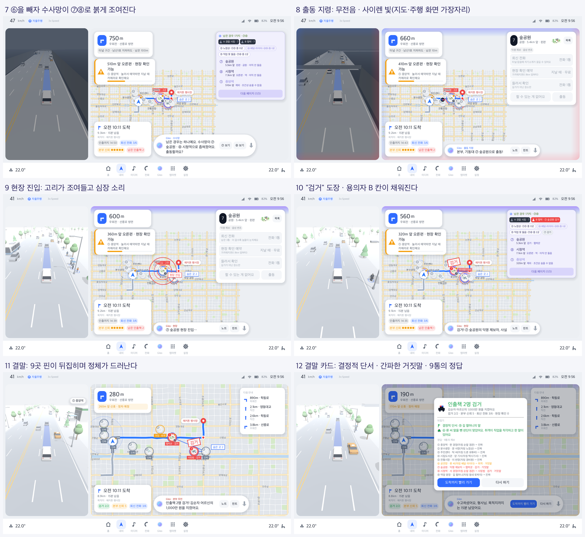
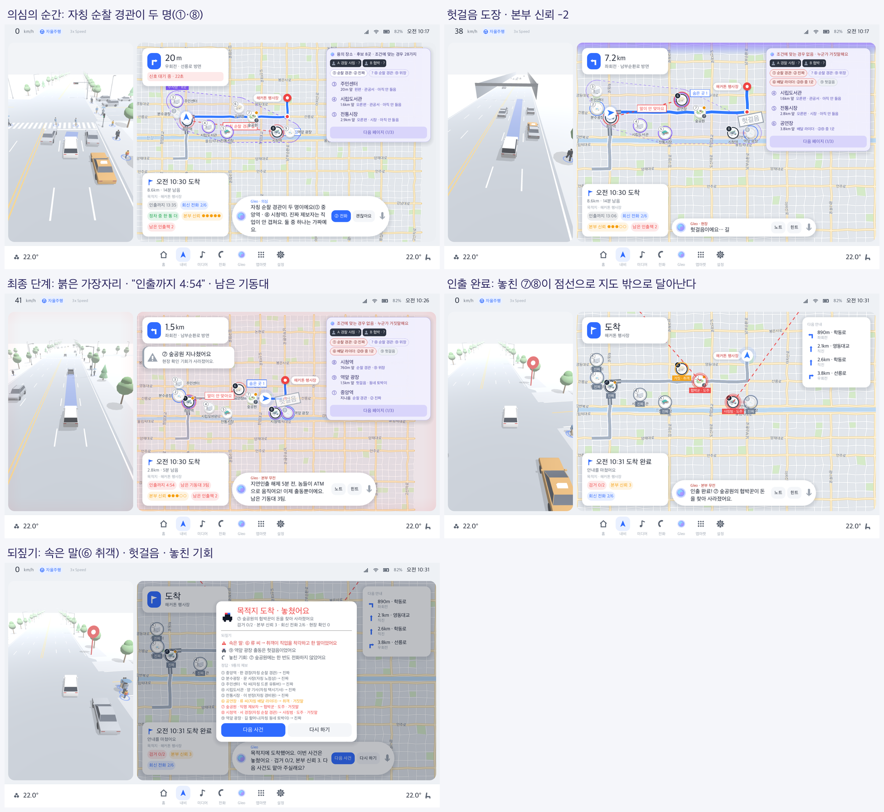

# 수사망 이야기 설정 (스토리 바이블, 2026-10-21)

호기심에 켠 사람이 "왜 이 퍼즐을 푸는지" 바로 납득하도록, 퍼즐 구조를 그대로 이야기로 옮긴 설정이다.
**규칙과 정답은 바꾸지 않는다.** 이야기는 Godot 화면 층(`StoryBook`)에만 있고, Python 퍼즐 공장과 팩, 봇 통계는 그대로다.

## 스토리보드

| 첩보에서 추리까지 | 확정과 검거 | 놓친 결말 |
|---|---|---|
|  |  |  |

## 1. 설정: "가짜 제보"

> 형사님, 본부 긴급 첩보예요. 경찰 사칭 보이스피싱 조직의 인출책 둘이 이 경로 주변에 숨었어요.
> 본부가 제보를 요청하자 9곳에서 한 통씩 왔어요. 그중 2통은 놈들이 수사를 흐리려고 건 가짜예요.
> **가짜 제보가 걸려 온 그 자리에 놈들이 있어요.**

이 한 줄이 퍼즐 구조를 다 설명한다.
- 장소마다 제보자가 한 명씩 있다.
- 다시 전화(회신 전화)하면 범인이 받는다. 자기가 건 제보이기 때문이다.
- 범인은 시민인 척 직업을 꾸며 대고 거짓말한다. 전화로 사람을 속이는 게 놈들의 일이다.
- 진술 속 "수상한 데"는 가짜 제보가 온 곳이다.
- 경관 행세(사칭범)는 보이스피싱의 실제 수법("경찰입니다")이라 반전이 자연스럽다.

## 2. 규칙마다 붙인 이야기 이유

그 규칙이 처음 쓰이는 순간 Gleo가 말한다.

| 규칙 | 이야기 이유 | 화면 말 |
|---|---|---|
| 9곳 중 2곳 | 제보 9통 중 2통이 가짜(대포폰) | 브리핑 1/3 "가짜 제보 2통을 찾아라" |
| 탐문 | 회신 전화 | "회신 전화 2/6", 통화 알약 |
| 통화 6번, 다 쓰면 최종 단계 | 더 걸수록 놈들이 눈치챈다 | "회신 전화가 너무 많았어요. 놈들이 눈치챘어요!" |
| 마감 = 도착 시각 | 지연인출 해제 시각. 피해자가 이체한 돈은 30분 뒤 인출할 수 있다 | 사건 파일 "9:20 이체 → 지연인출 30분 → 9:50 인출", 칩 "인출까지 12:34" |
| 도착 5분 전 최종 단계 | 놈들이 ATM으로 움직인다 | "지연인출 해제 5분 전, 놈들이 ATM으로 움직여요!" |
| 최종 출동 기회 | 남은 기동대 | "남은 기동대 3팀" |
| 신뢰도 | 본부 신뢰. 헛걸음 출동이면 깎이고 0이면 수사에서 빠진다 | "본부 신뢰 ●●●●●" |
| 잠복(항상 참) | **현장 확인**: 지나가며 차량 카메라로 제보 *내용*을 직접 확인(사람을 보는 게 아니다) | "★ 현장 확인 · ① 중앙역 제보 내용을 카메라로 확인했어요…" |
| 경유지 잠복 | 들러서 확인. 본부가 지급정지를 걸어 몇 분 벌었다(마감이 늦어지는 이유) | "들러서 확인 · +2분 · 전화 1통" |
| 터널 | 회선 잡음으로 자기소개가 끊긴다 | "??? · 직업 못 들음(잡음)" |
| 신호 대기 보너스 | 정차한 틈에 한 통 더 | "정차 중 한 통 더" |
| 힌트 | 본부 분석팀 조회(본부 신뢰 -1) | "본부 분석팀 조회: …" |
| 같은 직업 둘이면 하나는 가짜 | 진짜 제보자는 직업이 안 겹친다(본부 확인) | 의심의 순간 "자칭 순찰 경관이 두 명이에요" |
| 협박꾼, 취객, 오지랖 | 협박당한 시민도 거짓말, 취객은 착각, 오지랖은 부풀림 | 브리핑 3/3. 정체는 결말에만 |
| 익명 제보 | 변조된 목소리로 들은 소문만 | "(음성 변조) 이름은 못 밝혀요. 들은 얘긴데요, …래요." |

## 3. 인물

- **플레이어:** 형사님(광역수사대). **Gleo:** 차 안 수사 파트너. **본부:** Gleo가 전하는 "본부 무전"으로만 나온다(첫 장면도 Gleo가 전한다).
- **조직:** 보이스피싱 사업부는 경찰 사칭 조직 "블랙콜"(가칭). 나머지 사건(쉬움·보통·어려움)은 불법 도박 조직 "흑사파".
- **용의자 칸:** 프리셋의 조직원 순서대로 A·B(·C). 처음엔 실루엣이고, 잡으면 "B 협박 · ⑦ 숲공원 검거"로 채워진다.
- **피해자:** 한 명에게 이름을 준다. "김순자(71) · 노후 자금 1,000만 원"과 사기 문자.
- **제보자 9명:**
  - 이름은 자칭 직업별 이름 목록에서 팩 시드와 장소 순서로 고른다. 예: 박 사장, 최 기사, 한 경장 / 서 경장.
  - 같은 자칭 직업이 둘이면 다른 이름을 준다.
  - 프로필은 성씨 원이고, 색은 자칭 직업으로 정한다.
  - 화면에는 늘 "자칭"을 붙인다.

## 4. 문구 원칙

- **정답 누설 금지.**
  - 플레이 중 문구, 이름, 프로필 색, 말투는 장소, 자칭 직업, 진술, 시드만으로 정한다.
  - `StoryBook`은 팩에서 정답·힌트·분석·잠복 진술을 뺀 사본만 들고 있다.
  - `test_story.gd`가 정답을 바꾼 팩에서도 문구가 같은지 확인한다.
  - 출동 결과에서도 "협박당함" 같은 숨은 정보는 밝히지 않는다. 결말에만 보인다.
- **규칙 설명 대신 이유.** "통화 6번"이 아니라 "회신 전화 6통: 더 걸면 놈들이 눈치채요".
- **잠복은 사람이 아니라 내용을 확인한다.** 숨은 곳을 현장 확인해도 범인이 드러나지 않는 이유다.
- **글자 수:** 카드 제목 ≤18자, 카드 줄 ≤28자, Gleo 자막 ≤64자, 진술 ≤80자(`test_story.gd`).
- **조사:** 장소 이름 뒤 조사는 받침에 맞춘다(`CaseDirector._josa`).

## 5. 한 판 흐름과 연출

효과음만 쓰고, 대사는 자막(타자 효과, 초당 45자, 누르면 끝까지)으로 보여 준다.

| 장면 | 연출 | 소리 |
|---|---|---|
| 긴급 첩보 | 사건 카드 "Gleo · 본부 긴급 첩보" | 알림 |
| 브리핑 1/3 제보 9통 | 1배속으로 늦추고 핀 9개가 하나씩 떨어진다 | 핀마다 핑 |
| 브리핑 2/3 사건 파일 | 긴급 도장, 피해자, 사기 문자 말풍선, 지연인출 시각, 용의자 A·B 실루엣 | — |
| 브리핑 3/3 놈들의 수법 | 이 판의 수법(사칭, 협박, 말썽꾼, 익명) + 우리 수단 | — |
| 회신 전화 | 통화 알약(음성 바 위)이 연결 중 → 프로필·이름·자칭 직업·통화 시간·말소리 막대 → 통화 종료. 끊으면 검색 카드로 돌아와 새 칩이 튀어나오고 경우의 수가 바뀐다 | 연결음, 딸깍, 뚜뚜 |
| 터널 통화 | "??? · 잡음으로 직업 못 들음", 자막 "(지지직…)" | 잡음 |
| 현장 확인 | 주행 화면에 뷰파인더 모서리 "● 현장 확인" | 셔터 |
| 수사망 | 남은 후보를 감싸는 점선 그물 "수사망 · N곳"이 겹쳐 사라지며 좁아진다. 1가지만 남으면 붉게 조인다 | 1가지일 때 핑 |
| 의심의 순간 | 같은 직업 두 명 / 말이 안 맞음: 두 핀 사이 빨간 점선과 이름표 | 의심 |
| 본부 무전 | 인출 12·8분 전, 첫 검거 뒤 | — |
| 최종 단계 | 지도·주행 화면 가장자리가 붉게 숨 쉰다. "인출까지 4:59" 빨강, "남은 기동대 N팀" | 경보, 마지막 30초 째깍·심장 |
| 출동 | 지령(무전) → 경찰 아이콘 이동 + 가장자리 빨강·파랑 사이렌 빛 + 3D 경찰차 추월 → 현장 진입(고리가 조여듦) → 도장 | 무전, 사이렌, 심장, 쿵 |
| 검거 / 헛걸음 | 핀 위 "검거"(빨강) / "헛걸음"(회색) 도장, 용의자 칸 채움 | 쿵(+실패음) |
| 결말 | 9곳 핀이 차례로 뒤집혀 정체 이름표(숨은 곳 빨강, 거짓말 주황, 진짜 회색). 놓친 범인은 깜빡이며 점선으로 지도 밖으로 달아난다. 3.2초 뒤 결말 카드 | 해결음 / 경보 / 실패음 |

### 결말 카드: "어디서 속았나" 되짚기

결말 카드에는 되짚기를 3줄까지 보여 준다.
- **해결:**
  - 결정적 단서: 출동 결과를 빼고 믿은 말만으로 1가지가 남을 때, 빼면 경우가 늘어나는 말.
  - 간파한 거짓말: 못 믿음으로 뺀 말 중 실제 거짓.
- **일부 검거 · 놓침 · 수사 제외:**
  - 속은 말: 믿었는데 거짓이었던 말과 그 이유(사칭범이 꾸민 말, 취객의 착각, 협박당한 시민, 오지랖의 부풀림).
  - 헛걸음 출동.
  - 놓친 기회: 숨은 곳인데 한 번도 전화하지 않은 곳.
- **정답 9줄:** "⑧ 시청역 · 서 경장(자칭 순찰 경관) → 사칭범 · 도주 · 거짓말"처럼 제보자 이름과 함께.

## 6. 어디를 고치면 되나

| 바꿀 것 | 파일 |
|---|---|
| 조직·피해자·문자·이름 목록·문구 틀 | `godot/data/story/<프리셋>.json`(없으면 `default.json`) |
| 이름 고르기, 익명·현장 확인 문장, 결말·되짚기 | `godot/scripts/case/story_book.gd` |
| 장면 순서, 통화·출동·결말 연출 타이밍 | `godot/scripts/case/case_director.gd` |
| 통화 알약 | `godot/scripts/case/call_pill.gd` |
| 수사망·점선·도장·정체 공개·도주 점선 | `godot/scripts/case/case_overlay.gd` |
| 가장자리 사이렌·최종 단계·뷰파인더 | `godot/scripts/shell/edge_fx.gd` |
| 효과음(코드로 합성, `assets/sfx/<이름>.wav`가 있으면 그 파일) | `godot/scripts/shell/sfx.gd` |
