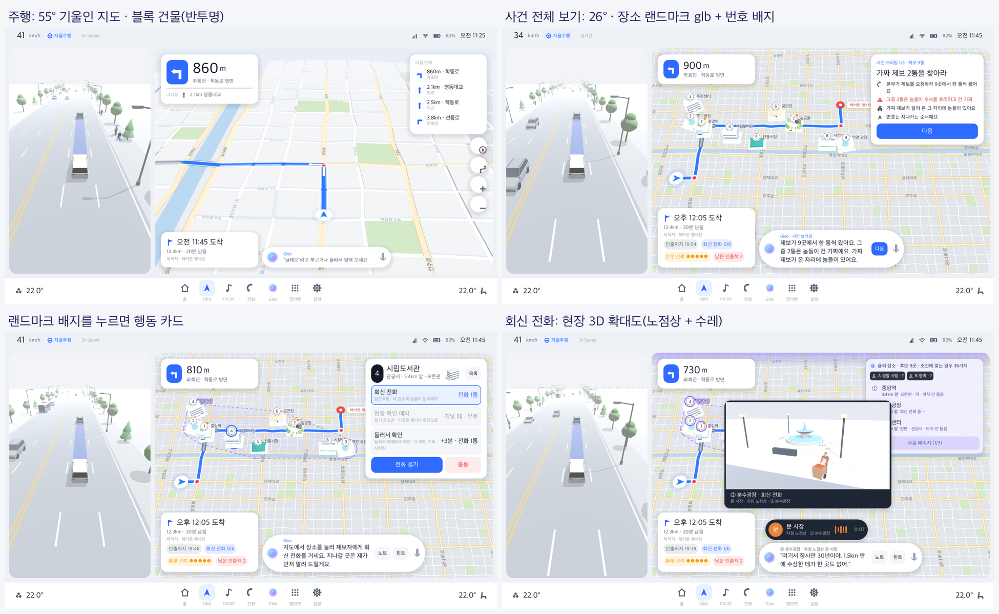
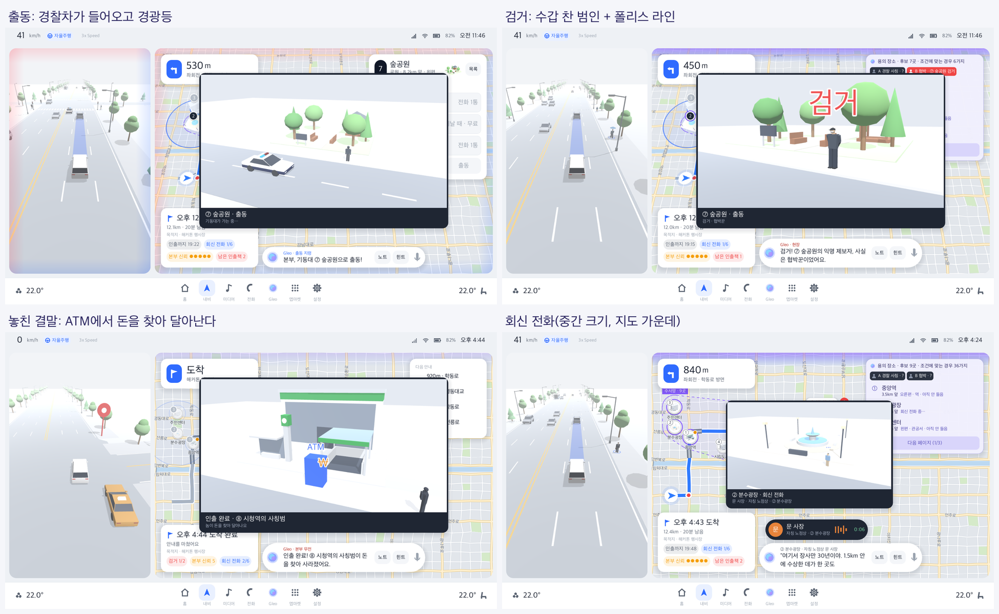
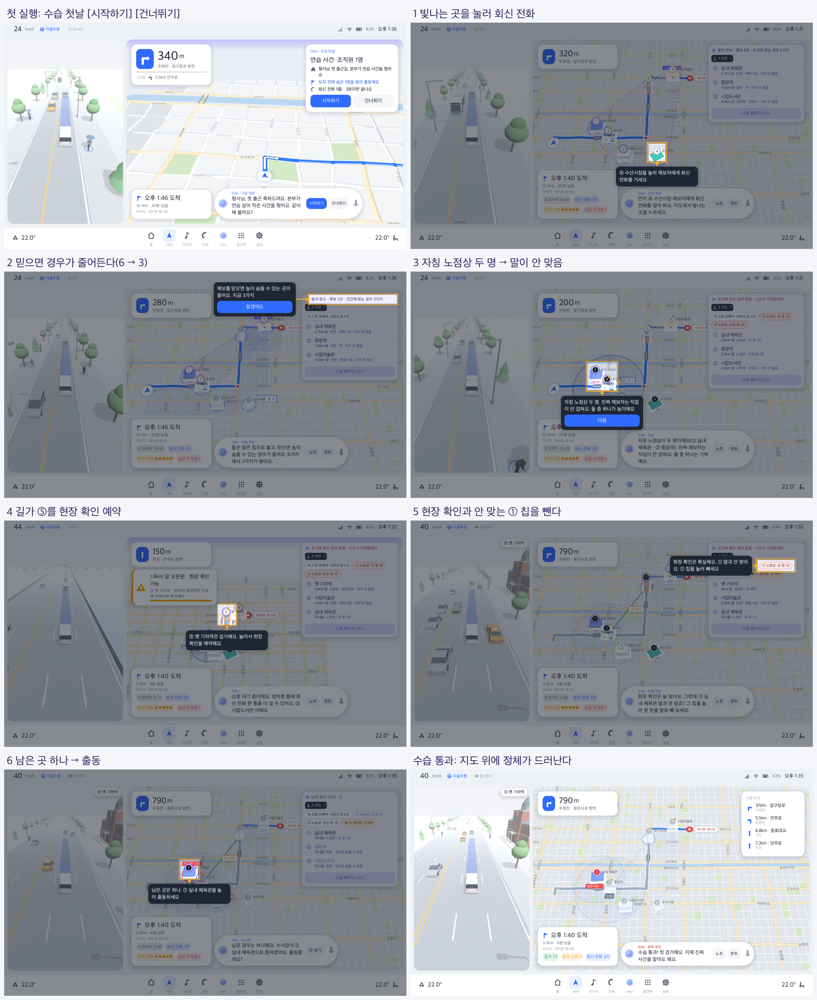

# 튜토리얼과 지도 풍성하게 (설계 2026-10-22, 구현 2026-10-23)

> **구현했다.** 맨 아래 "구현 결과"와 스토리보드를 보라.

두 가지를 다룬다.
1. **튜토리얼:** 데모 판(발표용)과 따로, 처음 하는 사람이 혼자서도 규칙을 익히는 길.
2. **오른쪽 지도:** Blender 에셋으로 내비 지도 화면을 더 풍성하게. 지금까지 Blender 에셋은 거의 왼쪽 주행 화면에만 쓰였다.

---

## 1. 튜토리얼

### 지금 문제
- 규칙은 브리핑 3장과 Gleo 말로만 배운다. 처음 하는 사람은 아래를 스스로 겪어 봐야 이해한다.
  - "칩을 누르면 경우의 수가 바뀐다"
  - "같은 직업이 둘이면 하나는 가짜"
  - "말이 부딪히면 하나를 뺀다"
- 데모 판(phishing-1000)은 장소 9곳, 거짓말 3종(사칭, 협박, 취객), 익명, 터널이 한꺼번에 나온다. 첫 판으로는 무겁다.
- 발표 데모는 발표자가 말로 이끈다. 혼자 하는 사람에게는 그 역할이 없다.

### 배워야 할 것 (순서대로, 한 번에 하나)
| # | 배울 것 | "아하" 순간 |
|---|---|---|
| 1 | 장소를 눌러 회신 전화 → 말이 칩으로 붙는다 | 칩이 생기고 수사망이 줄어든다 |
| 2 | 경우의 수 = 남은 가능성. 말을 믿으면 줄어든다 | 6 → 4가지 |
| 3 | "자칭" 직업은 믿을 수 없다. 같은 직업이 둘이면 하나는 가짜 | 경관이 두 명 → 빨간 점선 |
| 4 | 말끼리 부딪히면(0가지) 하나를 뺀다 | 칩을 눌러 빼자 1가지로 |
| 5 | 길가는 지나가며 현장 확인 = 확실한 말 | ★ 칩, 뺀 말이 맞았는지 확인 |
| 6 | 1가지 남으면 출동 | 검거 도장 |

배우지 않아도 되는 것(나중에 맥락 도움말로): 들러서 확인, 힌트, 터널, 신호 대기, 노트.

### 추천: "수습 첫날" 가이드 판 + 첫 판 코치 팁

**A. 수습 첫날 (전용 튜토리얼 판, 약 3분)**
- 설정: "형사님 첫 출근길, 본부가 연습 삼아 작은 사건 하나를 줬어요."
- **보드를 줄인다.**
  - 장소 6곳, 숨은 곳 1곳(행동대원 1명, C(6,1)=6가지)이다.
  - 말썽꾼은 없다. 거짓말은 위장 1종만 나온다.
  - 장소를 6곳으로 줄이는 것은 퍼즐 공장이 이미 지원한다(`make_city_board(rng, n)`).
  - 정답이 하나로 정해지는지는 솔버로 검증한다.
- **판을 손으로 짠다(시드 고정).** 각 단계에서 위 "아하"가 반드시 나오게 진술을 고른다. 예:
  - ② 노점상 "①③엔 없음" → 6 → 4가지
  - ⑤ 자칭 경관 "④ 신분 속임" vs ⑥ 자칭 경관 "④ 진짜" → 경관 두 명, 하나는 가짜
  - ④ 길가 현장 확인 → 확실한 말로 누가 가짜인지 확정 → 1가지 → 출동
- **코치 마크:**
  - 화면의 나머지를 어둡게 하고, 눌러야 할 곳만 밝게 뚫는다(스포트라이트).
  - 화살표와 한 줄 안내를 붙인다.
  - 그 행동을 해야 다음으로 넘어간다(게이트).
  - 단계 사이에는 Gleo가 "왜 그런지"를 한 줄로 말한다.
- **시간 압박 없이:**
  - 튜토리얼 중에는 1배속으로 달린다.
  - 마감(최종 단계)은 마지막 단계 전까지 오지 않게, 짧은 경로에 넉넉한 통화 수를 준다.
  - 코치 마크를 기다리는 동안에는 자율주행이 그대로 달리되, 사건 시계는 멈춘다.
- **끝:** "수습 통과" 도장. [진짜 사건 맡기(데모 판)]로 이어진다.

**B. 첫 판 코치 팁 (맥락 도움말, 모든 판)**
- 처음 겪는 순간에 한 번만, 지도 위에 작은 말풍선(코치 마크 축소판)을 띄운다. 예:
  - 첫 터널 통화: "터널 잡음으로 직업을 못 들었어요"
  - 첫 신호 대기: "정차 중엔 한 통 더"
  - 첫 힌트, 첫 들러서 확인
- 본 팁은 저장해 다시 띄우지 않는다. 발표 데모 모드(`--mode=demo`)에서는 끈다.

**모드 나누기**
| 모드 | 언제 | 무엇 |
|---|---|---|
| `tutorial` | 처음 켰을 때 기본(건너뛰기 가능) | 수습 첫날 → 데모 판으로 |
| `play` | 튜토리얼을 마친 뒤 | 팩 순서대로, 첫 판 코치 팁 |
| `demo` | 발표 | 지금 흐름 그대로, 팁 없음, 발표자 단축키 |

### 구현 메모 (정한 뒤)
- 튜토리얼 팩:
  - `prototype/tutorial_pack.py`가 easy 팩의 도시·경로를 쓰고, 장소 6곳에 역할과 단서를 직접 정한다.
  - 솔버로 정답이 하나인지 검사한 뒤 `godot/data/puzzles/tutorial-1.json`으로 내보낸다.
  - 봇 통계와는 무관하다.
- Godot:
  - `scripts/case/tutorial.gd`: 단계 목록 `[{target, text, say, wait_for}]`과 게이트.
  - `scripts/shell/coach_mark.gd`: 스포트라이트와 화살표.
  - `CaseDirector`에 단계 신호를 둔다(통화 끝, 칩 토글, 0가지, 현장 확인, 검거).
  - 이야기는 `data/story/tutorial.json`.
- 테스트: `test_tutorial.gd`가 단계를 순서대로 밟아 끝까지 가는지, 게이트가 다른 행동을 막는지 본다.

---

## 2. 오른쪽 지도를 풍성하게 (Blender)

### 지금
- 지도는 2D 벡터다. 블록, 공원, 강, 도로 등급, 다리, 도로 이름을 그린다.
- 사건 장소는 원 안에 랜드마크 썸네일을 넣은 핀이다.
- Blender 에셋(차 9종, 사람 4종, 소품 6종, 랜드마크 11종)은 거의 왼쪽 3D 주행 화면에만 쓴다.
- 그래서 오른쪽은 "평평한 지도 + 동그란 핀"이고, 사건이 벌어지는 장소가 장소처럼 느껴지지 않는다.

### 실제 내비에서 가져올 것
- 확대하면 랜드마크 건물이 입체 아이콘으로 서 있다(3D 랜드마크).
- 교차로·출구를 큰 그림으로 보여 주는 **3D 확대도** 카드가 있다.
- 도로 위 교통 흐름, 공원 나무, 강 같은 살아 있는 표현이 있다.

### 제안 4가지 (효과 큰 순)

**① 현장 3D 확대도 카드 (추천 1순위)**
- 회신 전화, 출동, 결말 때 지도 위에 작은 3D 창(SubViewport)을 띄운다. 그 장소의 랜드마크 모델과 인물·차량을 보여 준다.
  - **회신 전화:** 장소 건물 앞에 제보자 인물(자칭 직업 모습)이 서 있다. 통화 중에는 말풍선이 뜬다.
  - **출동:** 경찰차가 건물 앞에 서고 경광등이 깜빡인다. 현장 진입 때 카메라가 천천히 다가간다.
    - 검거면 인물 위에 수갑, 헛걸음이면 물음표가 뜬다.
  - **결말:** 놓친 범인이 ATM 앞에서 돈을 들고 달아난다. 잡았으면 경찰차 옆에 선다.
- 실제 내비의 "확대도"와 같은 문법이라 내비 화면답다. 지금 있는 랜드마크·경찰차·사람 모델을 바로 쓴다.
- **Blender 새 에셋:**
  - 제보자 인물 8종(자칭 직업별 소품: 노점 수레, 택시기사 모자, 드론, 배달 헬멧, 경비 제복, 경관 제복, 토박이, 오지랖)과 익명 실루엣
  - ATM, 수갑, 폴리스 라인 테이프

**② 지도 위 3D 랜드마크 (추천 2순위)**
- 사건 장소를 동그란 핀 대신 지도 위에 선 입체 건물 그림(정사영 렌더 스프라이트)으로 그린다.
  - 번호 배지와 상태 테두리는 건물 위에 띄운다.
  - 멀리 보면 지금 핀, 가까이 보면 건물로 바꾼다.
- 결말에서 "정체가 드러나는" 연출이 건물 위에서 일어나 더 장소답다.
- **Blender 새 에셋:**
  - 랜드마크 11종을 지도 각도(북쪽 위, 위에서 50~60°)로 512px 렌더하고 그림자를 굽는다.
  - 상태별 변형(평소 / 수사망 안 / 제외되면 흐린 회색)은 Godot 셰이더로 처리한다.

**③ 살아 있는 지도 (3순위)**
- 큰길을 따라 작은 차 스프라이트가 흘러간다(위에서 본 차 6종).
- 공원에는 나무 윗면 스프라이트, 강에는 유람선이 지나간다.
- 출동하면 경찰 아이콘이 동그라미 대신 경광등이 깜빡이는 경찰차 윗면 그림이 된다.
- **Blender 새 에셋:** 차량 윗면 렌더(경찰차는 경광등 켜짐·꺼짐 2장), 나무 윗면 3종, 유람선.

**④ 3D로 기울인 지도 (나중에)**
- 실제 내비의 3D 보기처럼 지도를 기울이고, 블록을 높이만큼 세운다.
- 효과는 크지만 지도 렌더러를 다시 짜야 해서(2D 벡터 → 3D) 해커톤 범위를 넘는다.

### 일 나누기
- **Blender 세션**(`tools/blender/`, `godot/assets/models/` 소유): 새 에셋 스크립트, 렌더, 목록 JSON, 검사.
  - 예: `make_figures.py`, `make_map_sprites.py`
- **이 세션:** 지도·카드 연결(`nav_map.gd`, `case_overlay.gd`, 새 `scene_inset.gd`), 연출 타이밍, 테스트.
- 에셋 규격은 기존 Blender README 규격을 따른다. 1 단위 = 1m, 정면 -Z, 무광 단색, 삼각형 상한, 목록 JSON.

---

## 정한 것 (2026-10-22, 사용자)
1. **튜토리얼:** 수습 첫날 가이드 판 + 첫 판 코치 팁.
2. **지도:** ① 현장 3D 확대도, ② 지도 위 3D 랜드마크, ④ 3D로 기울인 지도. ③ 살아 있는 지도는 하지 않는다.
3. **3D 확대도 자리:** 지도 가운데에 크게(컷신처럼).
   - 회신 전화 때는 가운데에 중간 크기(약 640×360)로 띄우고, 통화가 끝나면 접는다.
   - 출동·결말 때는 크게(약 960×540) 띄운다.
4. **기울인 지도:** 하이브리드.
   - 지금 2D 지도 그림을 기울인 판에 붙이고, 그 위에 랜드마크 glb와 블록 건물을 세운다.
   - 주행(따라가기)은 55°, 사건 전체 보기는 20~30°로 살짝 기울인다.

## 만드는 계획

### 하이브리드 기울인 지도 (② 3D 랜드마크도 여기서 해결)
- **그리기 구조:**
  - 지금 `NavMap`(도시·경로·단서 도형·수사망)은 화면 대신 SubViewport에 그린다.
  - 그 텍스처를 3D 공간의 판(MeshInstance3D)에 붙인다.
  - 카메라는 따라가기에서 내 차 뒤 위, 55°로 둔다. 전체 보기에서는 경로 전체가 들어오게 거리를 맞추고 20~30°로 둔다.
- **판 위에 세우는 것:**
  - 사건 장소: 실제 랜드마크 glb를 세운다. 전체 보기에서도 보이게 4~6배 키운다.
    - 번호 배지와 상태 테두리는 화면 좌표로 투영해 2D로 그린다(글자가 기울지 않게).
  - 블록 건물: 도시 블록 다각형을 시드에 따른 높이로 세운 밝은 상자다. 공원·강가는 낮게 두고 경로 가까이는 투명도를 올린다.
  - 내 위치 화살표, 목적지, 경찰 아이콘은 3D 아이콘이나 투영한 2D로 그린다.
- **바닥에 그대로 남는 것:** 도로, 이름, 경로선, 단서 도형, 수사망 그물, 점선. 기울어진 판에 함께 눕는다.
- **누르기:** 화면 좌표 → 카메라 광선 → 판과의 교점 → 월드 좌표로 바꾼 뒤 지금 `pick()`을 그대로 쓴다.
- **위험:**
  - 먼 쪽 도로 이름이 작아진다(실제 내비와 같다).
  - SubViewport 2D와 3D를 동시에 그린다(M1 Pro에서 60fps 목표, 스크린샷 fps로 확인).
  - 전체 보기 카드 여백(`view_insets`)을 3D 카메라 맞춤으로 옮겨야 한다.

### ① 현장 3D 확대도 (지도 가운데)
- `scripts/case/scene_inset.gd`: 따로 SubViewport 3D 장면이다. 바닥 판 + 그 장소 랜드마크 + 인물·차량 + 카메라 연출로 이뤄진다.
  - **회신 전화(중간 크기):** 제보자가 건물 앞에 서 있고, 통화 중에는 말풍선 막대가 뜬다. 익명이면 실루엣, 터널이면 화면 잡음이 낀다.
  - **출동(크게):** 경찰차가 들어와 서고 경광등이 깜빡인다. 현장 진입 때 카메라가 천천히 다가가고, 결과에 따라 수갑 또는 물음표가 뜬다. 도장은 지금처럼 찍힌다.
  - **결말(크게):** 놓친 범인은 ATM 앞에서 돈을 들고 달아나고, 잡은 범인은 경찰차 옆에 선다.
- 처음에는 지금 있는 보행자 모델로 자리를 잡고, Blender 인물이 오면 바꾼다.

### Blender 세션에 맡길 에셋
| 에셋 | 내용 | 상한 |
|---|---|---|
| 제보자 인물 8종 | 노점상(앞치마+수레), 택시기사(모자), 드론 유튜버(드론+조종기), 동네 토박이(지팡이), 배달 라이더(헬멧), 경비원(제복), 순찰 경관(제복+모자), 오지랖 주민(장바구니) | 각 600 |
| 익명 제보자 | 후드 쓴 실루엣(얼굴 없음) | 400 |
| 범인 포즈 | 달아나는 자세(가방), 수갑 찬 자세 | 각 500 |
| 소품 | ATM, 수갑, 폴리스 라인 테이프(기둥 2+띠), 돈 가방 | 각 300 |
- 규격은 기존 README와 같다(1m 단위, 정면 -Z, 무광 단색, 썸네일, 목록 JSON `figures/figures.json`).
- 인물은 진짜 정체와 무관하게 **자칭 직업 모습**만 있다. 누설 금지 원칙.

### 순서 (추천)
1. **현장 3D 확대도:** 지금 에셋으로 먼저 만든다. Blender 인물은 동시에 만든다.
2. **하이브리드 기울인 지도 + 3D 랜드마크:** 가장 큰 구조 변경이라 튜토리얼보다 먼저 한다.
3. **튜토리얼:** 코치 마크는 화면 배치가 굳은 뒤 붙인다. 순서는 튜토리얼 팩(Python, 6곳) → 코치 마크와 단계 → 첫 판 팁 → 모드 나누기.
- 단계마다 테스트와 스크린샷으로 확인한다. 지금 테스트(사건 흐름 149, 이야기 1832 등)는 그대로 통과해야 한다.

---

## 구현 결과 (2026-10-23)

| 기울인 지도 | 현장 3D 확대도 |
|---|---|
|  |  |

### 기울인 지도 (`scripts/nav/map_view_3d.gd`)
- **바닥:** NavMap(도시·경로·이름·단서·수사망)을 SubViewport 텍스처로 그려 3D 판에 붙인다.
  - 텍스처는 0.8배 해상도로 그리고, 앞쪽 1700px까지만 그린다. 그 너머는 깊이 안개로 흐린다.
  - 따라가기는 55°, 전체 보기는 26°로 기울이고 두 각도 사이를 부드럽게 바꾼다.
  - NavMap에는 `fit_rect`(전체 보기 맞춤 영역)와 `follow_anchor`(내 차 자리)를 둔다. 기울인 판에서 화면에 보이는 영역을 투영해 넣는다.
- **판 위:**
  - 사건 장소: 랜드마크 glb. 멀리 봐도 화면에서 70px쯤 보이게 키우고, 정면은 경로 쪽을 본다. 핀이 떨어지는 연출에 맞춰 위에서 내려앉는다. 제외된 곳은 회색으로 작아진다.
  - 블록 건물: 높이를 세운 반투명 상자다. 가까이 볼 때(따라가기)만 보이고, 전체 보기에서는 낮아지며 사라진다.
- **화면:** 번호 배지와 이름은 글자가 기울지 않게 화면 좌표로 투영해 그린다(`CaseOverlay.draw_upright`). 바닥에는 상태 고리만 남는다.
- **누르기:** 랜드마크 배지를 먼저 본다. 아니면 화면 → 카메라 광선 → 판 → NavMap px → 월드로 바꿔 `NavMap.tapped`를 그대로 낸다.
- **성능:** M1 Pro 창 모드에서 약 57fps다. 평평한 지도는 `--flat-map`으로 켠다.

### 현장 3D 확대도 (`scripts/case/scene_inset.gd`)
- **회신 전화(640×340):** 연결 중에는 건물만 보이고 "따르릉"이 뜬다. 연결되면 자칭 직업 모습의 제보자가 나타난다.
  - 익명이면 후드 실루엣이 나온다.
  - 터널이면 화면에 잡음이 낀다.
  - 드론 유튜버는 드론이 떠서 흔들린다.
- **출동(960×520, 지도 가운데):** 경찰차가 들어오고 경광등이 깜빡인다. 현장 진입 때 카메라가 다가간다.
  - 검거면 수갑 찬 범인, 폴리스 라인, "검거"가 뜬다.
  - 헛걸음이면 "?"가 뜬다.
- **결말:** 놓쳤으면 ATM 앞에서 돈 가방을 든 범인이 달아난다. 다 잡았으면 경찰차 옆에 "검거 완료"가 뜬다. 이어서 지도 위 정체 공개, 그다음 결말 카드가 나온다.
- **인물·소품:** Blender 세션이 만든 `assets/models/figures/`(`figures.json`)다. 자칭 직업 8종, 익명, 범인 두 자세, ATM·수갑·폴리스 라인·돈 가방이 있다.
  - `AdasAssets` 목록에 넣어 이름(id)으로 꺼낸다.
  - 파일이 없으면 보행자 모델과 단순 도형으로 대신한다.

### 수습 첫날 (`scripts/case/tutorial.gd`, `scripts/shell/coach_mark.gd`)
- **판:** `prototype/tutorial_pack.py`가 장소 6곳, 행동대원 1명, 말썽꾼 없음, 통화 5번인 판에서 아래 순서가 반드시 나오는 시드를 고른다. 결과는 `godot/data/puzzles/tutorial-5004.json`이다.
  - 첫 통화(④): 6 → 3가지
  - 자칭 노점상 두 명(①·②): 다 믿으면 0가지
  - 길가 ⑤ 현장 확인 "② 깨끗": ①과 안 맞음
  - ① 칩을 빼면 1가지(①)
  - 출동
  - 정답이 하나인지는 솔버로 검증한다. 팩 목록(index.json)에는 넣지 않는다.
- **진행:**
  - 코치 마크가 화면을 어둡게 하고 누를 곳만 밝힌다. 장소를 고르면 그 카드의 버튼을 가리킨다. 말풍선과 화살표, 필요하면 [다음]이 붙는다.
  - 그 단계가 아닌 행동은 막고, Gleo가 "빛나는 곳부터"라고 말한다.
  - 1배속으로 달린다. 현장 확인 창이 열릴 때까지와 예약한 뒤 지날 때까지는 14배속으로 간다. 현장 확인 뒤에는 차를 세워 마감이 오지 않게 한다.
  - 신호 대기 보너스와 Gleo 권유는 끈다.
- **문구:** `data/story/tutorial.json`의 `coach`. 첫 장면 카드는 [시작하기] [건너뛰기]이고, 통과하면 결말 카드에 [진짜 사건 맡기](데모 판)가 뜬다.
- **언제 뜨나:**
  - 처음 켰을 때(통과 전) 자동으로 뜬다. 진행은 `user://progress.cfg`에 남는다.
  - `--tutorial`이면 늘 뜬다.
  - 발표(`--mode=demo`), 사건 지정(`--puzzle`), 자동 실행·스크린샷, 헤드리스에서는 뜨지 않는다.
- **처음 겪는 규칙 팁:** 다른 판에서 터널, 신호 대기, 현장 확인 찬스, 말이 안 맞음, 최종 단계를 처음 겪을 때 작은 말풍선을 한 번 띄운다. 본 팁은 저장한다. 발표·자동 실행에서는 끈다.
- **테스트:** `tests/test_tutorial.gd`(26개). 단계를 순서대로 밟아 수습 통과까지 가는지, 다른 행동이 막히는지 본다. `test_case_flow`에는 기울인 지도의 배지 누르기를 더했다.
