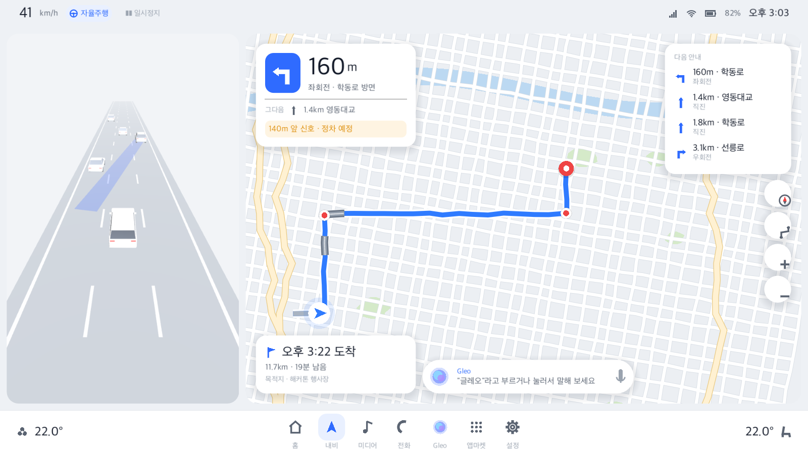
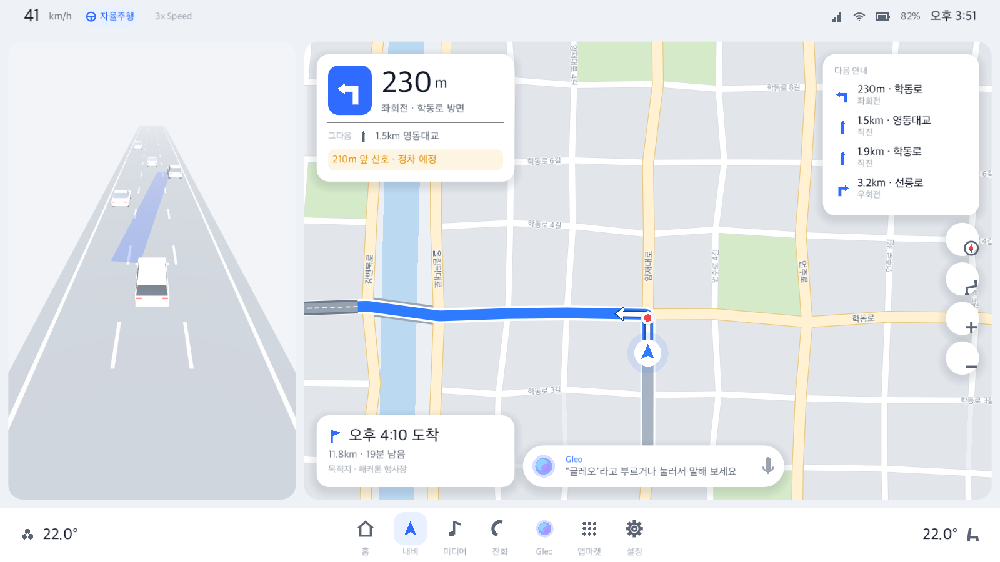
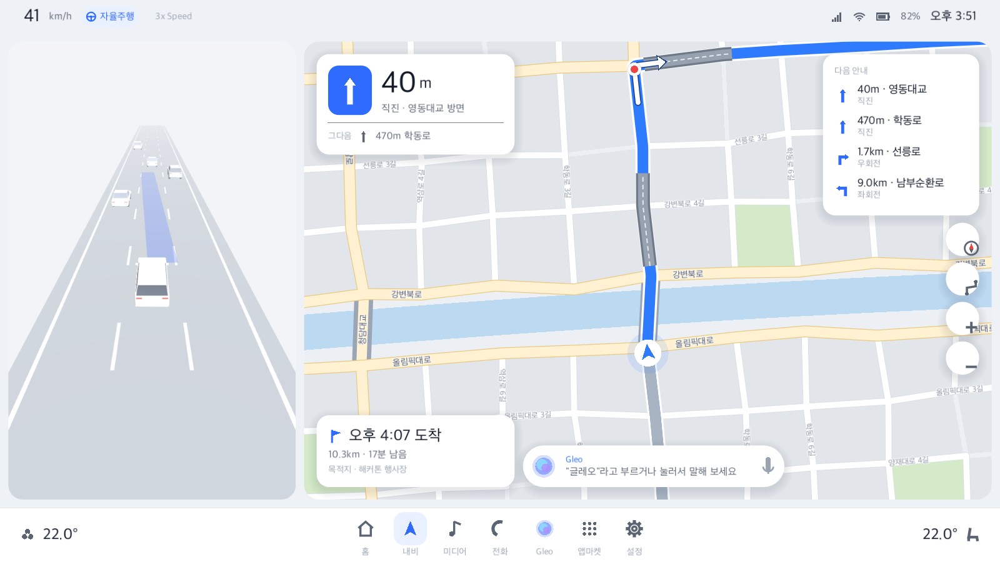
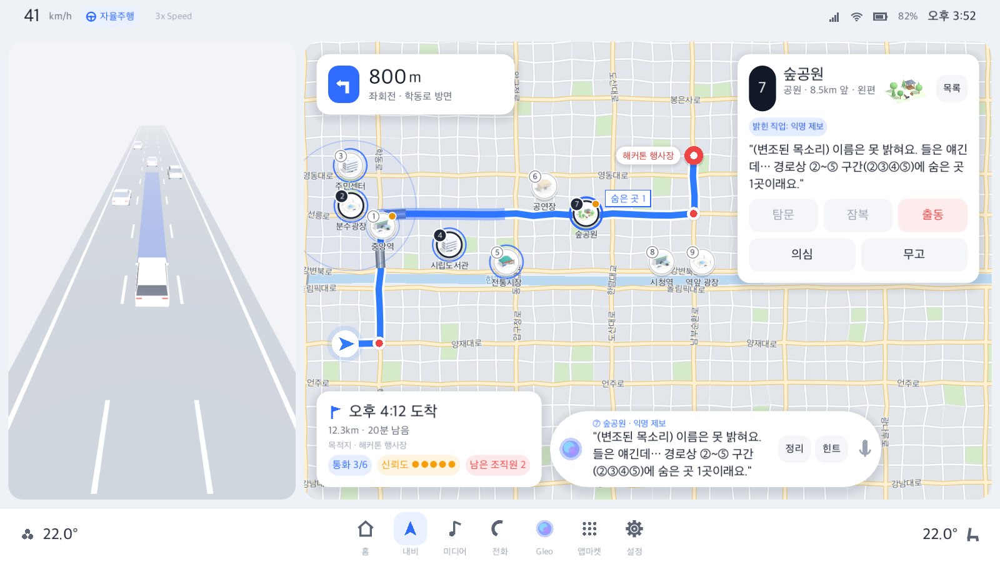
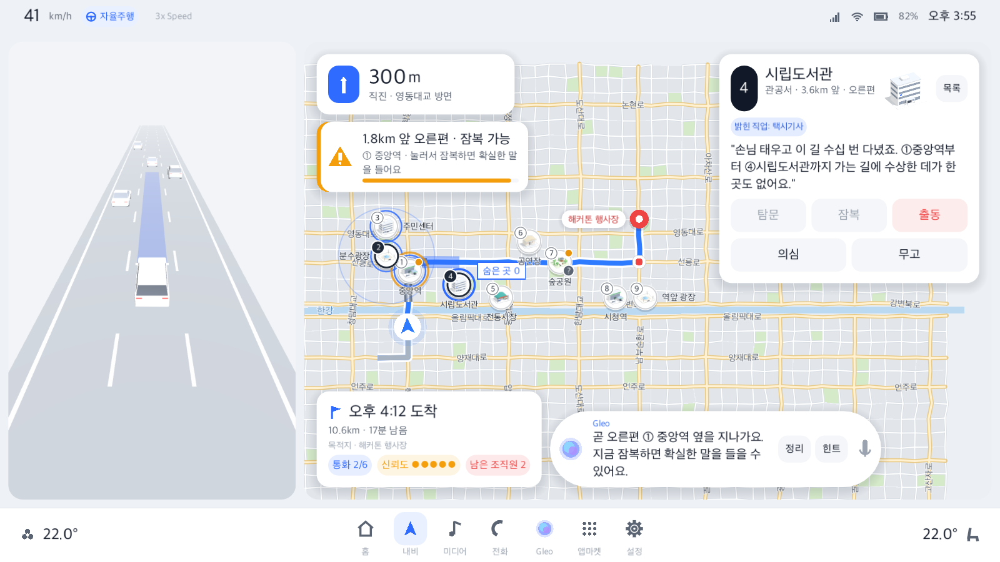
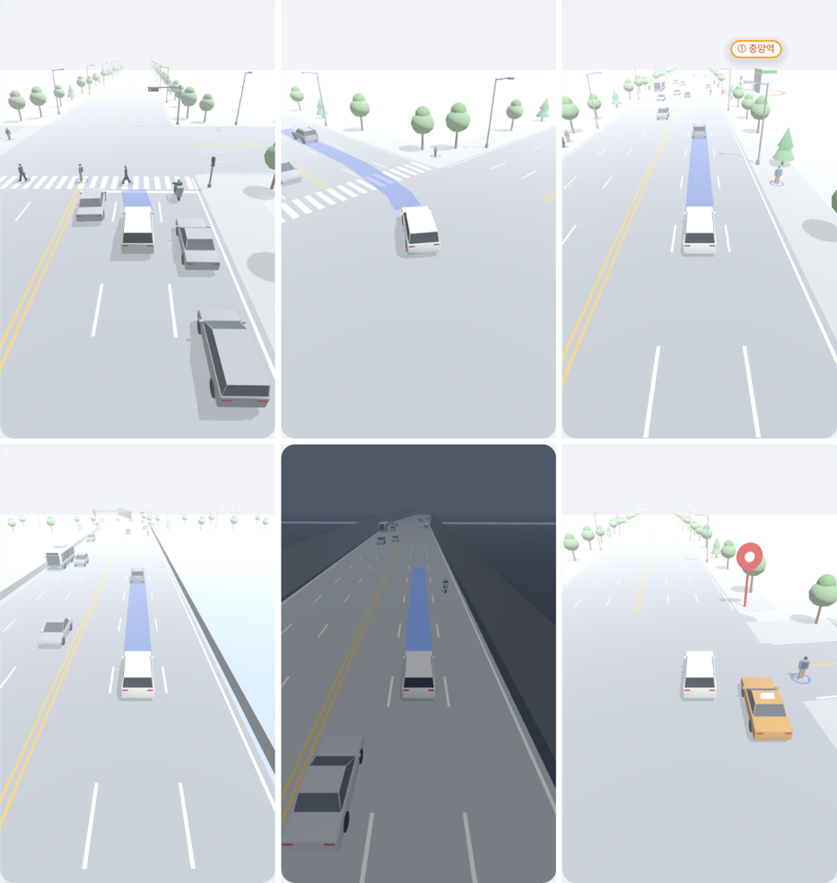
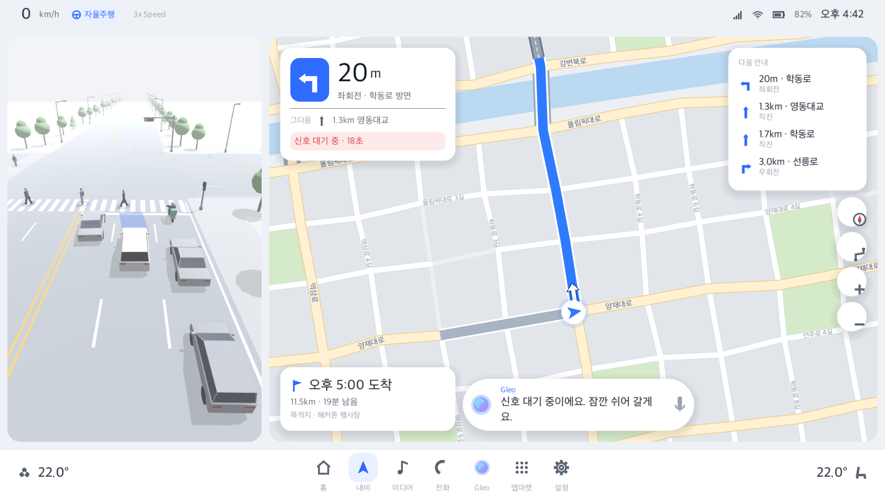
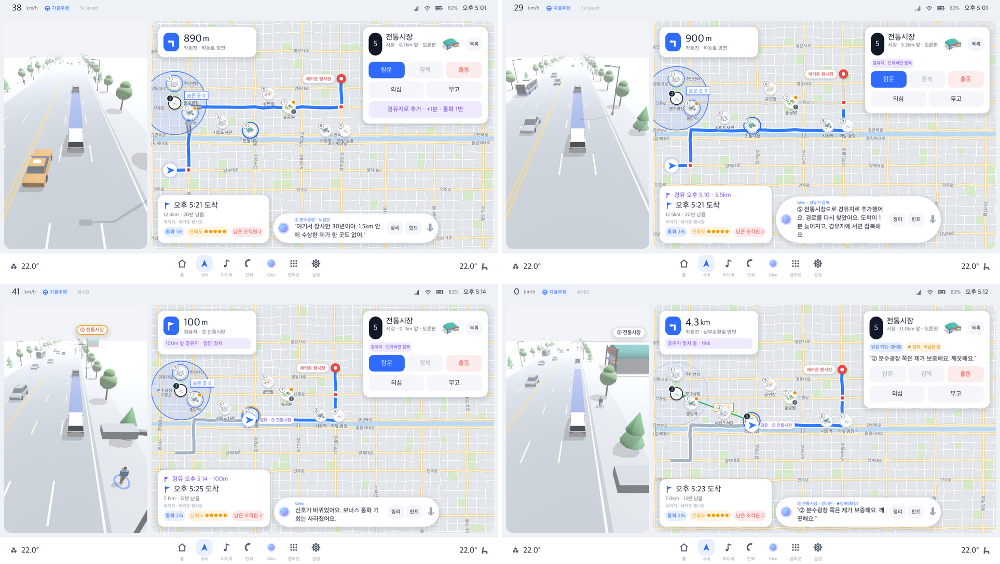

# 데모를 그럴듯하게: 가상 도시, A* 경로, 경유지, 주행 화면 연출 (설계안)

> 상태: 설계안(2026-10-20). 실제 경로·POI(단계 B)는 뒤로 미루고, 해커톤 데모의 완성도를 먼저 올린다.
>
> **V1 완료(2026-10-20).**
> - 무엇이 들어갔나:
>   - `prototype/puzzle/city.py`: 가상 도시, A*(이동 시간 + 회전 벌점, 유턴 금지), 경유지 경로, 경로 계획(회전 안내, 신호, 지하차도)
>   - 퍼즐 보드가 도시 위로 옮겨졌다(`make_city_board`). 팩 v3로 내보내고, Godot이 팩의 경로 계획을 쓴다.
> - 검증:
>   - A* 비용이 다익스트라와 같다.
>   - 봇 통계는 쉬움 90%, 보통 76%, 어려움 92%, 보이스피싱 82%(찍기 없이 해결)로 목표를 넘었다.
>   - Godot 테스트 전부 통과.
> - 남은 것: 지도 배경이 아직 예전 가짜 도시다. V2에서 팩의 `city`를 그린다.
>   
>
> **V2 완료(2026-10-20).** 내비 지도가 팩의 가상 도시를 그린다(`godot/scripts/nav/nav_map.gd`).
> - **도시:**
>   - 블록, 공원, 강을 메시 하나로 그린다.
>   - 도로는 등급별로 그린다. 이면도로는 흰 길, 간선도로는 노란 넓은 길, 다리는 난간을 둔다.
>   - 같은 이름 도로 조각은 한 줄로 이어 그린다(725조각 → 약 350줄).
> - **외곽:** 팩 도시는 경로 둘레만 있어서, 전체 보기로 줄이면 가장자리가 비어 보였다.
>   - 격자를 바깥으로 이어 외곽 동네(그림만, 동서 18열·남북 10행)를 덧붙인다.
>   - 이를 위해 팩 `city.grid`(열·행·강 위치)를 추가했다. 퍼즐 내용은 그대로다.
> - **도로 이름:** 간선도로, 다리, 한강, 이면도로(가까이 볼 때만) 이름을 도로 방향으로 쓴다.
>   - 겹치는 이름, 경로선에 걸리는 이름, 화면에서 가까이 반복되는 같은 이름은 뺀다.
> - **회전 화살표:** 아직 안 지난 좌·우회전 지점마다 경로선 위에 흰 꺾인 화살표를 그린다. 따라가기 보기에서만 보인다.
> - **목적지:** 핀 옆에 "해커톤 행사장" 말풍선을 단다. 오른쪽 카드에 가리면 왼쪽으로 옮긴다.
> - **장소 핀:**
>   - 둥근 랜드마크 썸네일(Blender 등각 이미지)에 번호 배지, 길가 점, 익명 "?"를 단다.
>   - 상태는 테두리와 배지 색으로 보인다.
>   - 멀리 볼수록 핀이 작아진다.
>   - 이름은 아래, 오른쪽, 왼쪽, 위 중 겹치지 않는 자리에 쓴다.
> - **전체 보기:**
>   - 경고 카드 자리는 경고가 떠 있을 때만 비우고, 지도는 새 여백으로 부드럽게 옮겨 간다.
>   - 여백은 m 대신 화면 px로 둔다.
> - **성능:** 도시 바탕은 뒤 층에 그리고, 지도 보기가 바뀔 때만 다시 그린다.
>   - 전체 보기는 26fps에서 60fps가 됐다. 따라가기 보기도 60fps다.
>   - 도시를 만드는 시간은 40ms 안팎이다.
> - **검증:** `godot/tests/test_nav_map.gd`(지도 16개, 229개 확인)를 추가했다. 기존 테스트도 전부 통과한다.
>
> 
> 
> 
> 
>
> **V3 완료(2026-10-20).** 왼쪽 주행 화면에서 차선을 흘려보내던 무대를 없앴다. 이제 내 차가 가상 도시의 A* 경로를 실제로 달리고, 카메라가 뒤에서 따라간다.
> - **도시(`adas_world.gd`):** 경로에서 300m 안의 도로만 3D로 만든다.
>   - 도로는 등급별 폭과 차선을 쓴다(간선·다리 편도 3차로, 이면도로 편도 1차로).
>   - 교차로 바닥, 중앙선·차선·가장자리선, 보도, 다리 난간, 강·공원 바닥을 깐다.
>   - 가로수 2종과 가로등은 MultiMesh로 둔다. 경로의 긴 간선도로에는 버스 정류장을 세운다.
>   - 지하차도는 실제 구간에 벽과 입구 보를 세운다. 도착 지점에는 빨간 목적지 핀을 세운다.
>   - 250m 덩어리로 나누고 보이는 거리(330m) 밖은 그리지 않는다. 만드는 데 0.1초 안팎이 걸린다.
> - **신호 교차로:** 경로가 지나는 간선 교차로와 신호 대기 지점마다 다음을 둔다.
>   - 차량 신호등(가로형), 보행 신호등, 앞뒤 횡단보도, 정지선
>   - 신호 대기 지점은 지나기 전과 대기 중에 빨간불이고, 출발하면 초록불이 된다.
> - **움직이는 것(`adas_traffic.gd`):**
>   - 차종은 7가지다(세단, SUV, 경차, 택시, 1톤 트럭, 시내버스, 배달 오토바이). 버스와 오토바이는 바깥 차로만 달린다. 택시 표시등을 켠다.
>   - 내 차로 앞차는 빨간불 전에 교차로를 빠져나간다. 옆 차로 차와 마주 오는 차는 빨간불이면 정지선 앞에 줄을 선다.
>   - 신호 대기 중에는 가로지르는 길로 차가 지나간다.
>   - 보행자 4종은 다리를 흔들며 걷고, 발밑에 파란 인식 링이 있다. 내 차가 정지선에 다가가면 횡단보도를 건넌다. 보도에도 걷는 사람이 있다.
>   - 출동하면 경찰차가 경광등을 깜빡이며 왼쪽 차로로 추월한다.
>   - 시간은 게임 시간(배속 반영)으로 흐른다.
> - **사건 장소(`roadside_landmarks.gd`):** 9곳 건물이 도시에 처음부터 서 있다.
>   - 길가 장소의 실제 위치(도로에서 40~55m)는 세로로 긴 패널 시야 밖이다. 그래서 3D에서만 보도 바로 뒤로 당겨 세우고, 그 앞 가로수를 비운다. 지도 위치는 그대로다.
>   - 사건을 수락하면 번호 표지가 켜진다. 잠복 찬스 중인 곳은 주황 테두리와 바닥 링으로 강조한다.
> - **조명:** Blender 미리보기와 같은 세기(환경광 0.25~0.3, 해 0.18~0.25)로 낮췄다.
>   - 예전 값(0.45/0.6)은 그림자를 받는 바닥이 하얗게 날아갔다.
>   - 바닥은 그림자를 받는다(그림자 진하기 0.55).
> - **검증:**
>   - `godot/tests/test_adas_world.gd`를 추가했다(도시 16개, 299개 확인).
>     - 신호 대기 지점마다 신호등이 있고, 내 차가 정지선 바로 뒤에 선다.
>     - 랜드마크가 보도 밖에 선다.
>     - 사건 3개를 끝까지 달려도, 빨간불일 때 앞범퍼가 정지선 앞에 있던 차가 선을 넘지 않는다. 차로 번호도 그 도로의 차로 수를 넘지 않는다.
>   - 60fps(10배속 포함). 기존 테스트도 전부 통과한다.
>
> 
> 
>
> **V4 완료(2026-10-20).** 경유지 표시, "경유지 잠복" 규칙, Godot A* 재탐색을 넣었다.
> - **Godot 길찾기(`godot/scripts/drive/city_router.gd`):** `city.py`의 A*(이동 시간 + 회전 벌점, 유턴 금지), 모서리 깎기, 도로 구간, 회전 안내를 옮겼다.
>   - 팩 16개 모두 Python과 같은 경로, 폴리라인, 회전 안내가 나온다(`test_city_router.gd`).
>   - A* 한 번에 수 ms다.
> - **재탐색:** 내 차보다 60m 넘게 앞인 첫 교차로에서 갈라진다.
>   - 장소에서 가장 가까운 도로를 지나 목적지로 간다. 두 방향을 다 해 보고 싼 쪽을 쓴다.
>   - 그 도로의 장소 쪽 지점(도로 20~80% 사이)에서 20초(게임 시간) 선다.
>   - 지나온 앞부분 폴리라인은 그대로라 누적 거리 s가 끊기지 않는다.
>   - 신호 대기 교차로와 지하차도는 새 경로가 같은 자리를 지나면 옮겨 온다.
> - **규칙(데모 규칙, Python 통계에는 넣지 않음):**
>   - 길가가 아닌 장소 카드에 [경유지로 추가 · +N분 · 통화 1번]이 뜬다. N은 새 경로로 갔을 때 늘어나는 ETA다(주행 시뮬레이션 속도 그대로).
>   - 판당 1번이고, 최종 단계에서는 못 쓴다. 경유지에 서면 그 장소의 잠복 진술(항상 참)을 자동으로 듣는다.
>   - 잠복 창은 처음 경로의 진행률 창과 같은 길이(m)를 "지금 경로" 위에서 잰다. 그래서 경로가 바뀌어도 새 경로에 남은 길가 장소는 그대로 잠복할 수 있다.
>     - 처음 경로에서는 팩의 `routePos`를 그대로 써서 Python 규칙과 같다.
>     - 설계안의 "250m 안에 들어왔다 나가면 끝"은 3배속에서 너무 짧아(약 12초) 쓰지 않았다.
>   - 진술 속 "경로 오른편", "③~⑥ 구간"은 처음 경로 기준 그대로다. 지도의 단서 도형도 처음 경로 위에 그린다.
> - **표시:**
>   - 지도: 옛 경로가 흐려지며 사라지고, 새 경로가 출발점부터 그려진다(1.8초). 경로 위에 보라색 경유지 배지("경유 · ⑤ 전통시장")를 달고, 지나가면 회색이 된다.
>   - TBT: "100m 경유지 · ⑤ 전통시장"(깃발). 안내 줄은 "100m 앞 경유지 · 잠깐 정차", 서 있는 동안은 "경유지 정차 중 · N초"다.
>   - 다음 안내 목록: 경유지 줄(깃발). 도착 카드: "경유 오후 5:14 · 100m" 줄이 위에 붙는다.
>   - 사건 목록·장소 카드: "경유지" 태그, "경유지 · 도착하면 잠복" 칩.
>   - 주행 화면:
>     - 3D 도시를 새 경로로 다시 만든다.
>     - 경유지 200m 앞부터 바깥 차로로 붙는다(같은 차로의 옆 차는 겹치지 않게 비켜 간다).
>     - 장소 건물은 차가 서는 곳 조금 앞 보도 뒤에 세우고, 다가가면 주황으로 강조한다.
> - **검증:**
>   - `test_city_router.gd`(경로 16개, 446개 확인)
>     - Python과 같은 경로가 나온다.
>     - 재탐색 뒤에도 앞부분이 그대로이고, 길이 이어지고, 유턴이 없다.
>     - 경유지가 장소에서 330m 안이다.
>   - `test_case_flow.gd`에 경유지 시나리오를 더했다(45개 확인). 추가하면 통화 1번, 경로 교체, 위치 유지, 도착 지연, 판당 1번, 경유지 정차와 잠복, 도착까지 본다.
>   - 기존 테스트도 전부 통과한다.
>
> 
>
> 관련: [demo-plan.md](demo-plan.md), Blender 에셋 [tools/blender/README.md](../tools/blender/README.md)

## 0. 지금 무엇이 어색한가
| 문제 | 원인 |
|---|---|
| 지도에서 경로가 길을 무시하고 사선으로 그어진다 | 경로(합성 곡선)와 배경 도로망(따로 만든 가짜 격자)이 서로 모른다 |
| 회전 안내가 거의 "직진"만 나온다 | 경로가 완만한 곡선이라 교차로·회전이 없다 |
| 왼쪽 주행 화면이 늘 같은 직선 도로다 | 3D 화면이 경로와 상관없이 차선만 흘려보낸다 |
| 사건 장소가 주행 화면에 안 보인다 | 3D 화면에 장소 개념이 없다 |

**해결 방향: 데모용 가상 도시 하나를 만들고, 내비 지도·경로·왼쪽 3D 화면·퍼즐 장소가 모두 그 도시를 같이 쓴다.**
나중에 실제 OSM 데이터(단계 B)로 바꿀 때도 같은 데이터 형식에 채우면 된다.

## 1. 가상 도시와 A* 경로 (Python 퍼즐 공장)
`prototype/puzzle/city.py`(신규)에서 도시를 만들고 퍼즐 보드도 그 위에 만든다.

### 도로망(그래프)
- **노드와 간선:** 교차로가 노드, 도로가 간선이다. 약 14km × 8km 범위.
- **간선 속성:** 길이, 도로 등급(간선도로 / 이면도로), 제한 속도(60 / 40km/h), 도로 이름.
  - 간선도로는 "테헤란로"처럼 이름 있는 넓은 길이다.
  - 이면도로는 격자를 조금 흔들어 만든다.
- **강:** 도시를 가로지르고, 다리 3~4개로만 건널 수 있다. 다리 하나는 지하차도(= 터널 이벤트)다.
- **공원·블록:** 공원 폴리곤과 건물 블록(도로 사이 칸)을 만든다. 블록은 지도 배경에 연한 회색 덩어리로 그린다.

### A* 경로
- **비용:** 이동 시간 = 길이 ÷ 속도 + 회전 벌점(좌회전 15초, 우회전 5초, 유턴 금지)
- **휴리스틱:** 직선거리 ÷ 최고 속도. 항상 최단 시간 이하라서 최적 경로를 보장한다.
- **경유지:** `A*(출발 → 경유지) + A*(경유지 → 도착)`을 이어 붙인다.
- **회전 안내:** 경로가 지나는 교차로에서 진행 방향 변화로 정한다.
  - 30° 이상이면 좌회전/우회전, 도로 이름만 바뀌면 "직진 · ○○로 방면".
  - 교차하는 도로 이름을 안내 문구에 쓴다("선릉로에서 우회전").
- **신호 대기:** 경로가 지나는 간선도로 교차로 중 2~3곳에 신호를 둔다.

### 퍼즐 보드
- 출발지와 목적지는 경로 길이가 약 10km가 되도록 고른다. 목적지 이름은 "해커톤 행사장"이다.
- 장소 9곳은 도시 블록의 필지 중에서 고른다.
  - 길가 2~3곳은 경로에 붙은 필지(도로에서 30~60m)에서 고른다. 주행 화면에서 실제로 보이는 거리다.
  - 나머지는 경로에서 0.4~1.5km 떨어진 필지에서 고른다.
- 이미 있는 `board_from_points(route, points)`를 그대로 쓴다. 지나가는 순서, 왼편/오른편, 길가 판정은 A* 경로 기준으로 다시 계산된다.
- 업종은 랜드마크 11종(`landmarks.json`)과 맞춘다.

### 내보내기 (퍼즐 팩 스키마 v3)
- `city`: 도로(폴리라인, 등급, 이름), 강, 다리, 공원, 블록
- `route`: 경로 폴리라인, 지나는 노드, 회전 안내, 신호, 터널(지하차도)
- 장소: `landmark` id 추가
- 모든 장소의 잠복 진술(항상 참): 지금은 길가만 있다. 경유지 잠복(4절) 때문에 전부 필요하다.
- 통계(봇)를 다시 돌려 난이도가 그대로인지 확인한다.

## 2. 내비 지도 (Godot `nav_map.gd`)
- **배경:** 퍼즐 팩의 `city`로 그린다(절차 생성 가짜 도시는 버린다).
  - 간선도로는 넓은 노란 길, 이면도로는 흰 길.
  - 강과 다리, 공원, 건물 블록.
  - 간선도로에는 도로 이름 라벨을 그린다.
- **경로:** 실제 길을 따라간다.
  - 회전 지점마다 경로선 위에 흰 화살표를 그린다(내비 표준 표현).
  - 지나온 구간은 회색으로 그린다.
- **사건 장소 핀:** 숫자 배지 위에 Blender 썸네일(256px 등각 이미지)을 작게 올린다. 지도 위에 미니 건물이 서 있는 느낌을 준다.
- **경로 탐색 연출(선택):** 목적지를 정하면 "경로 탐색 중…" 동안 A*가 탐색한 노드가 옅은 점으로 퍼졌다가 경로가 그려진다. 발표 때 A*를 눈으로 보여 주는 장면이다.

## 3. 경유지 표시 (내비 관례)
| 위치 | 표시 |
|---|---|
| 지도 | 경로 위 경유지 배지(깃발 + "경유"). 지나가면 회색. 다시 계산할 때는 옛 경로가 흐려지고 새 경로가 출발점부터 그려진다 |
| TBT 카드 | 경유지가 다음 안내가 되면 "300m 앞 경유지 · ⑤ 수영장" |
| 다음 안내 목록 | 회전 안내 사이에 "경유지" 줄(깃발 아이콘) |
| 도착 카드 | 두 줄: "경유 오후 2:31 · 3.2km" / "도착 오후 2:44 · 10.4km" |
| 경유지 도착 | Gleo: "경유지에 도착했어요." 잠깐 서행·정차 후 다시 안내 |

## 4. 게임 규칙에 녹이기: "경유지 잠복" (추천 하이라이트)
Dupery의 "조사에는 시간이 든다"를 내비 언어로 옮긴 장치다.
- **동작:** 길가가 아닌 장소의 카드에 [경유지로 추가 · +N분]이 있다. N은 A* 우회 시간 차이다.
  - 누르면 경로를 다시 찾고(Godot에서 A* 재탐색), 그 장소를 지나가면서 잠복한다. 진술은 항상 참이다.
- **대가:** 통화 1회를 쓰고, 도착이 N분 늦어진다. 판당 1번만 쓸 수 있고, 최종 단계에서는 못 쓴다.
- **보드 기준은 그대로:** 진술 속 "경로 오른편", "③~⑥ 구간"은 처음 경로 기준으로 고정한다. 판이 시작되면 보드는 바뀌지 않는다는 원칙과 같다.
  - 경유는 차의 실제 이동만 바꾼다.
- **잠복 판정 변경:** 진행률 창 대신 **차와 장소 사이 거리**(250m 안에 들어왔다가 멀어지면 끝)로 바꾼다. 길가 장소와 경유지 모두 같은 규칙으로 처리된다.
- **분류:** 이 규칙은 데모 규칙이다(터널 은폐, 보너스 통화와 같은 분류). Python 봇 통계에는 넣지 않는다.

## 5. 왼쪽 주행 화면 연출 (Godot `adas_view.gd` 재작성)
지금은 "차선을 흘려보내는 무대"다. 이것을 **"도시 속을 실제로 달리는 카메라"**로 바꾼다.
- **도로:** 경로 폴리라인과 교차로 주변 도로를 3D 띠 메시로 만든다.
  - 카메라가 차를 따라 실제 경로 위를 움직이니, 교차로 회전, 곡선, 다리, 지하차도가 지도와 똑같이 나온다.
- **스타일:** Pleos·Tesla 시각화처럼 미니멀하게 간다. 흰 배경에 회색 도로, 차선만 두고, 일반 건물은 넣지 않는다.
  - 대신 아래 요소만 넣는다.

| 요소 | 연출 |
|---|---|
| 차량 다양화 | 세단·SUV(있음)에 더해 시내버스, 택시, 1톤 트럭, 경차, 배달 오토바이. 색은 회색 계열에 버스·택시만 은은한 색. 반대 차로에는 마주 오는 차, 앞차는 차간거리 유지, 가끔 차로 변경, 신호에서 함께 정지 |
| 가로수 | 보도 양쪽에 12m 간격, 2종을 크기·회전만 바꿔 MultiMesh로 배치(교차로는 비움). 연한 초록이라 미니멀 톤을 해치지 않는다 |
| 횡단보도·보행자 | 신호 정지 교차로마다 정지선 바로 앞에 얼룩말 무늬 횡단보도와 보행 신호등. 차가 서면 보행자 3~5명이 길을 건넌다(다리를 앞뒤로 흔드는 걷기). 사람에는 옅은 파란 인식 링을 둬서 "보행자 인식" 느낌을 준다. 초록불이 되면 다 건넌 뒤 출발. 중간 블록에 신호 없는 횡단보도 1곳에서 "보행자 인식 감속" 이벤트(영상의 보행자 인식 장면) |
| 사건 장소 랜드마크 | 길가 장소의 랜드마크 모델을 실제 위치(경로 옆 30~60m)에 세운다. 지나갈 때 그 편에 실제로 보인다. 잠복 가능할 때 바닥에 주황 링, 잠복하면 "잠복 중" 표시 |
| 경유지 | 경유지 장소 랜드마크 앞으로 차가 들어가 잠깐 선다 |
| 출동 | 경찰차가 추월(있음). 사칭범 검거 때 경광등 깜빡임 |
| 터널(지하차도) | 실제 지하차도 구간에서 벽과 천장 조명(지금의 어두워짐 연출을 실제 위치에 맞춤) |

## 6. Blender 세션에 요청할 에셋
규격은 지금과 같다: 1 단위 = 1m, 앞쪽 -Z, 무광 단색, 원점은 바닥 중앙.

| 묶음 | 내용 | 비고 |
|---|---|---|
| 차량 5종 | 시내버스, 택시(지붕 표시등), 1톤 트럭, 경차, 배달 오토바이(사람 포함) | 모델당 삼각형 1,200개 이하 |
| 보행자 3~4종 | 정장, 캐주얼, 아이, 우산 든 사람 | 다리를 `LegL`, `LegR` 노드로 분리(걷기 흔들기용). 삼각형 400개 이하 |
| 길거리 소품 | 가로수 2종(둥근 활엽수, 원뿔 침엽수), 가로등, 차량 신호등(가로형), 보행 신호등, 버스 정류장(선택) | 신호등은 빨강·초록 램프를 따로 노드로 |
| 지도 아이콘 | 이미 있는 랜드마크 썸네일을 그대로 쓴다 | — |

## 7. 진행 순서 (제안)
| 단계 | 내용 | 결과 |
|---|---|---|
| V1 | 가상 도시 + A* 경로 + 퍼즐 보드 이전(Python), 팩 v3, 통계 재확인 | 회전 안내가 살아 있는 경로, 길 위의 장소 |
| V2 | 내비 지도: 도시 그리기, 회전 화살표, 도로 이름, 장소 썸네일 핀 | 지도가 진짜 내비처럼 보인다 |
| V3 | 왼쪽 주행 화면 재작성: 실제 경로 따라가기, 교차로, 가로수, 횡단보도·보행자, 랜드마크, 차량 다양화(에셋 도착 전에는 상자 임시) | 지도와 주행 화면이 맞아떨어진다 |
| V4 | 경유지: 표시(지도, TBT, 목록, ETA) + 게임 규칙 "경유지 잠복" + Godot A* 재탐색 | 발표 하이라이트 |
| V5 (선택) | 경로 탐색 연출, 차로 변경, 버스 정류장 정차 | 연출 보강 |

- V1·V2가 기반이고, V3와 Blender 에셋(6절)은 동시에 진행할 수 있다.
- V4는 V1(그래프)과 V2(표시)가 끝나야 한다.
