# 수사망 Godot 데모

Godot 4.7(GDScript, Compatibility 렌더러, 1920×1080). 계획은 [docs/demo-plan.md](../docs/demo-plan.md)에 있다.

- **메인 씬:** `scenes/pleos_shell.tscn`. Pleos 차량 화면을 재현한 셸이다(단계 C).
  - 차가 경로를 따라 달리고, TBT·ETA·다음 안내·속도·시각이 자동으로 갱신된다(단계 D).
  - 터널과 신호 대기 이벤트도 있다.
  - 주행 중 Gleo가 사건을 제안하고, 같은 화면 위에서 한 판이 끝까지 진행된다(단계 E). 아래 "사건 모드"를 보라.
- **예전 프로토타입 화면:** `scenes/main.tscn`. 어두운 UI에 탐문·잠복·급습이 다 되는 버전이고, 규칙 확인용으로 남겨 두었다.

| 주행 | 터널 | 신호 대기 | 도착 |
|---|---|---|---|
| 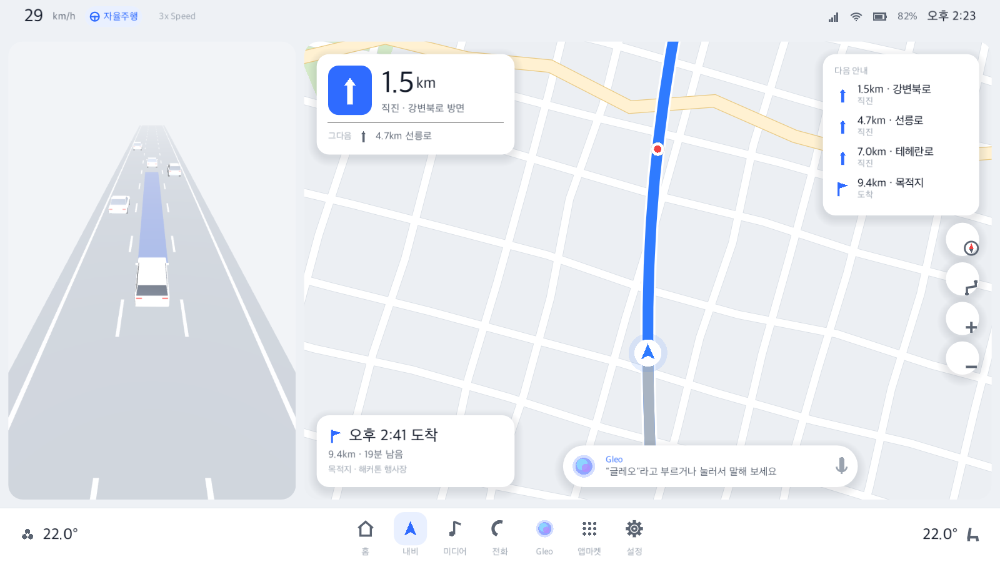 | 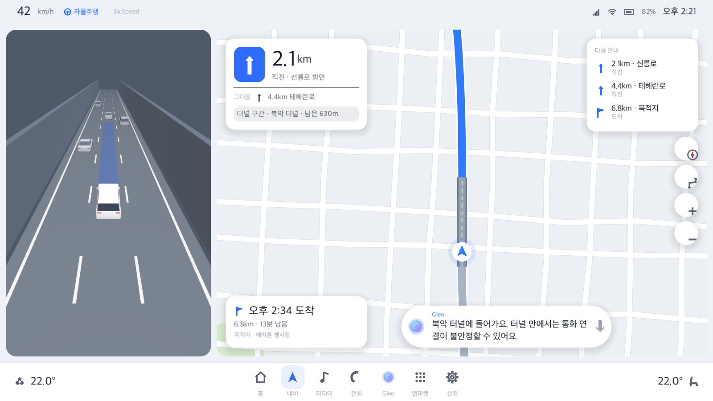 | 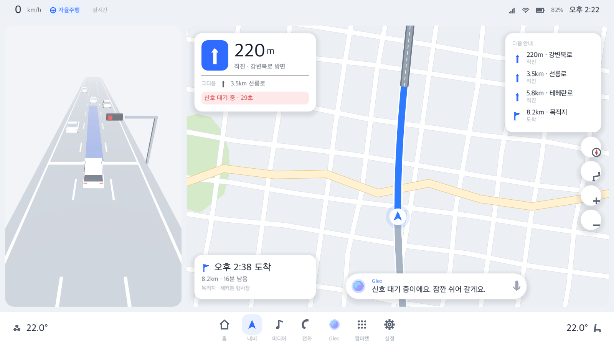 | 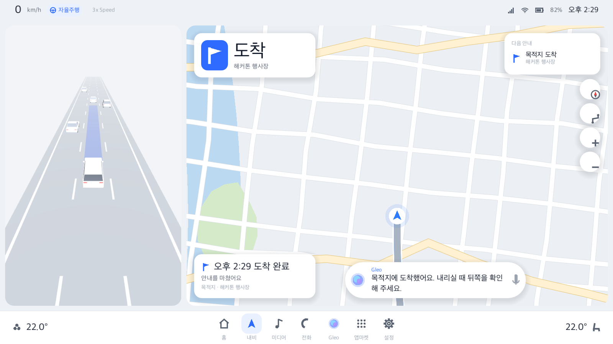 |

| 사건 제안 | 탐문 | 출동 | 최종 단계 | 결과 |
|---|---|---|---|---|
| 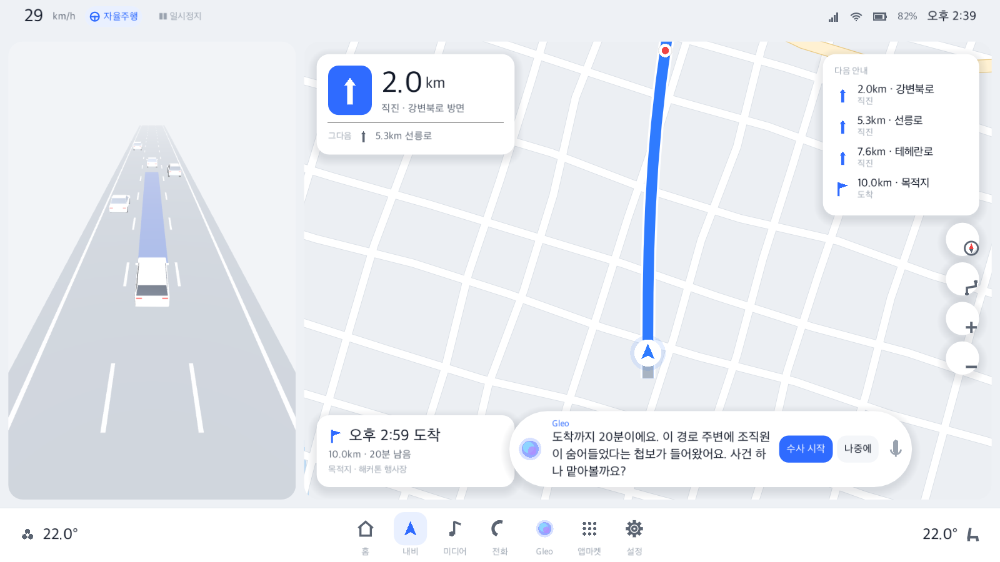 | 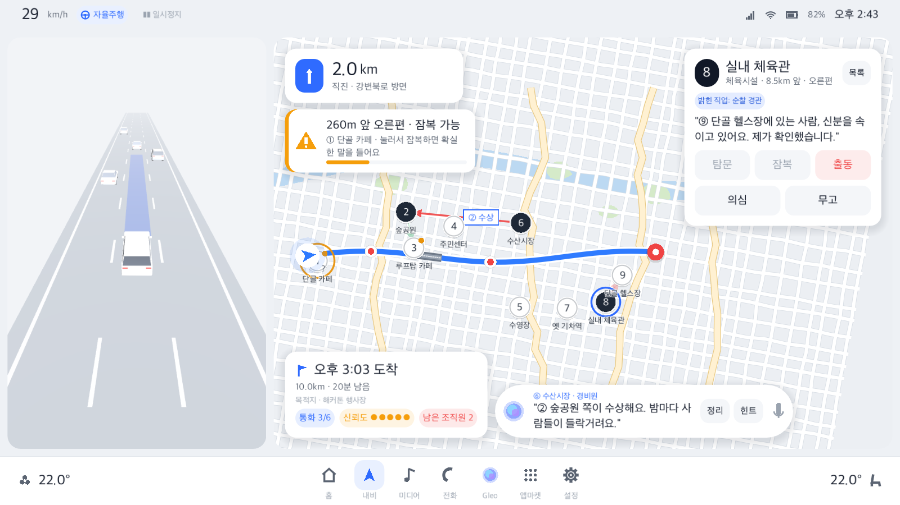 | 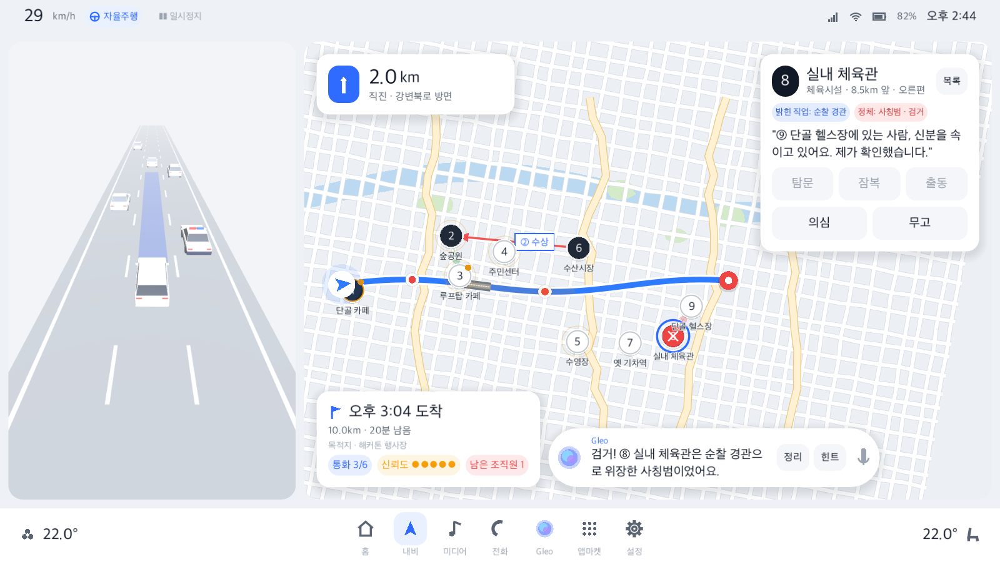 | 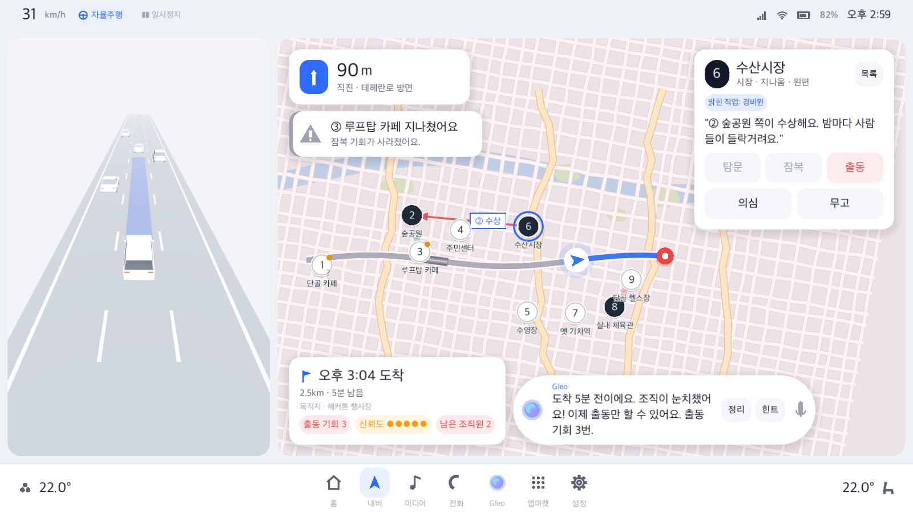 | 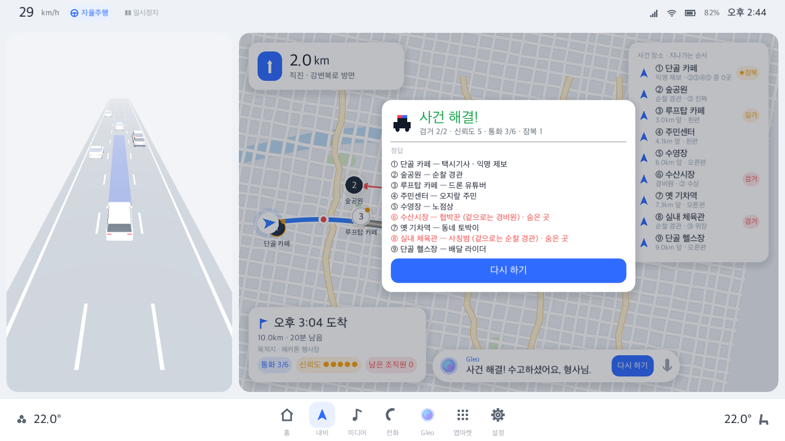 |

## 사건 모드 (단계 E)
화면 구성은 그대로 두고, 내비 부품에 사건을 얹는다.
이야기("가짜 제보" 설정, 규칙별 이야기 이유, 인물, 연출)는 [docs/story-bible.md](../docs/story-bible.md)에 있다.
기울인 지도, 현장 3D 확대도, 튜토리얼 '수습 첫날'은 [docs/tutorial-and-map-plan.md](../docs/tutorial-and-map-plan.md)에 있다.
- **처음 켜면** 튜토리얼 '수습 첫날'(6곳, 숨은 곳 1곳, 약 3분)이 뜬다. [건너뛰기]를 누르거나 통과하면 데모 판으로 간다.
- 발표 때는 `--mode=demo`로 튜토리얼과 팁을 끈다.

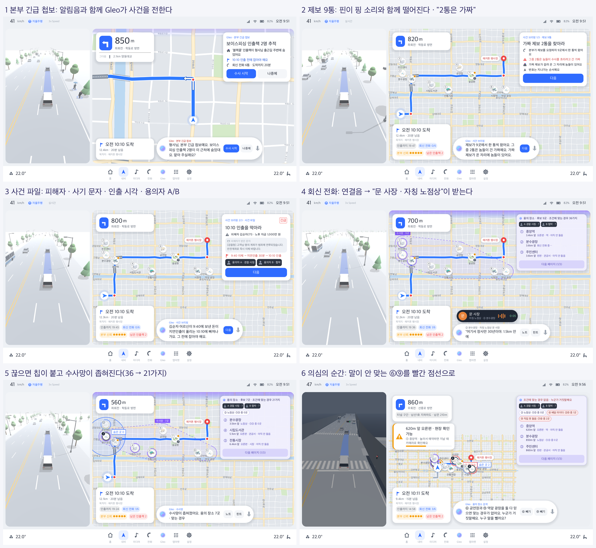

| 흐름 | 화면 |
|---|---|
| 긴급 첩보 | 출발 후 게임 시간 35초에 알림음과 함께 "Gleo · 본부 긴급 첩보" 카드가 뜬다. [수사 시작] [나중에] |
| 브리핑 3장 | ① 제보 9통(9곳 중 2통은 놈들이 건 가짜, 핀이 핑 소리와 함께 떨어짐) ② 사건 파일(피해자·사기 문자·지연인출 시각·용의자 A/B) ③ 놈들의 수법. 누를 때만 넘어가고, 읽는 동안 1배속 |
| 용의 장소 검색 | 오른쪽 위 보라 Gleo 카드. 머리줄에 "후보 N곳 · 조건에 맞는 경우 M가지", 들은 진술 칩(누르면 믿음 ↔ 못 믿음), 남은 후보를 지나가는 순서로 3줄씩 + [다음 페이지]. 빠진 곳은 지도에서 회색으로 작아진다. 믿는 말끼리 부딪혀 0가지가 되면 빨간 머리줄과 함께 Gleo가 "누구 말을 뺄까요?"를 묻는다. 1가지면 출동을 권한다. 자세한 설계는 [deduction-ux.md](../docs/deduction-ux.md) |
| 회신 전화(탐문) | 핀이나 검색 결과 줄을 누르면 행동 옵션 카드(회신 전화 / 현장 확인 예약 / 들러서 확인 + [출동]). 전화를 걸면 음성 바 위 통화 알약이 연결 중 → "문 사장 · 자칭 노점상" → 통화 종료로 바뀌고, 말은 Gleo 바에 타자 치듯 나온다. 끊으면 검색 카드로 돌아와 새 칩이 반짝이고 수사망(후보를 감싸는 점선 그물)이 좁혀진다 |
| 의심의 순간 | 같은 직업 두 명, 믿는 말끼리 부딪힘: 두 핀 사이 빨간 점선과 경고음 |
| 잠복 | 길가 장소에 다가가면 TBT 아래에 경고 카드("260m 앞 오른편 · 잠복 가능")가 뜨고 줄어드는 막대가 남은 시간을 보여준다. 카드를 누르면 잠복. 지나치면 "지나쳤어요" |
| 경유지 잠복 | 길가가 아닌 장소 카드에서 [경유지로 추가 · +N분 · 통화 1번]을 누르면 Godot A*로 경로를 다시 찾는다. 지도에서 옛 경로가 사라지고 새 경로가 그려지며, 경유지 배지·TBT·도착 카드에 경유지가 붙는다. 경유지에 20초 서면서 그 장소의 잠복 진술(항상 참)을 듣는다 |
| 출동 | [출동]을 두 번 누른다. 지령(무전음) → 경찰 아이콘 이동과 화면 가장자리 사이렌 빛(3D 경찰차 추월) → 현장 진입(고리·심장 소리) → 핀 위 "검거"/"헛걸음" 도장, 용의자 칸 채움 |
| 정리 · 힌트 | Gleo 바의 [정리]는 수사 노트(들은 진술 전체)를 연다. [힌트]는 믿는 말 중 거짓말 하나, 없으면 뺀 말 중 참인 것 하나를 짚는다(신뢰도 -1). 둘 다 없으면 "모두 맞게 골랐어요"라고 답하고 이때도 신뢰도를 쓴다 |
| 최종 단계 | 도착 5분 전이나 통화를 다 쓰면 지도가 붉게 물들고 출동만 할 수 있다 |
| 결말 | 핀 9곳이 뒤집히며 정체가 드러나고, 놓친 범인은 점선으로 지도 밖으로 달아난다. 결말 카드에 되짚기(결정적 단서 / 속은 말·놓친 기회)와 제보자 이름이 붙은 정답 9줄. [도착까지 빨리 가기]·[다음 사건]·[다시 하기] |

데모 규칙(Python 통계에는 없음):
- **터널 은폐:** 터널 안에서 통화하면 잡음 때문에 제보자의 직업을 못 듣는다(진술 내용은 들린다).
- **신호 대기 보너스 통화:** 신호 대기 중에 보너스 통화 1번이 생기고 예산을 쓰지 않는다. 판당 1번이고, 신호가 바뀌면 사라진다.
- **경유지 잠복:** 통화 1번, 판당 1번, 최종 단계 전에만. 도착이 늦어진다. 진술 속 구간·편은 처음 경로 기준 그대로다.
  - 경로가 바뀌어도 잠복 창은 "지금 경로" 위 거리로 잰다. 처음 경로에서는 Python 규칙과 같다.

사건 모드 카드 견본(`--showcase`): 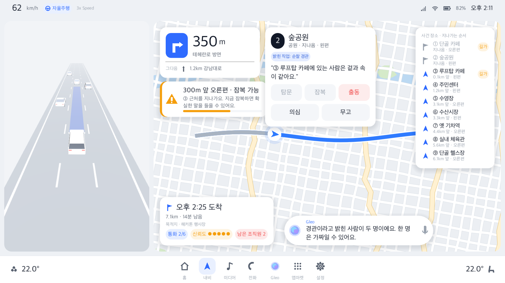

## 실행
```bash
godot --path godot
```
에디터로 열려면 아래 명령을 쓴다.
```bash
godot --editor --path godot
```
처음 한 번은 import로 클래스 캐시를 만든다.
```bash
godot --headless --path godot --import
```
예전 프로토타입 화면은 이렇게 연다.
```bash
godot --path godot res://scenes/main.tscn
```

### Pleos 셸 실행 인자 (`--` 뒤에 붙인다)
| 인자 | 내용 |
|---|---|
| `--puzzle=phishing-1000` | 경로를 가져올 사건(실제 경로 데이터가 생기기 전 임시). 없으면 보이스피싱 사건 |
| `--speed=3` | 배속: 1(실시간), 3(기본, 영상의 "3x Speed"), 10, 0(멈춤) |
| `--start=0.18` | 출발 진행률(`--progress`와 같다) |
| `--seek=stop` | 장면 바로 앞으로 건너뛰기: `stop`(첫 신호 대기), `tunnel`(첫 터널), `arrive`(도착) |
| `--simulate=90` | 화면을 띄우기 전에 게임 시간 N초를 미리 진행 |
| `--view=overview` | 지도 보기: `follow`(진행 방향이 위) 또는 `overview`(경로 전체) |
| `--showcase` | 사건 모드 카드(잠복 경고, 장소 카드, 장소 목록, 사건 정보 칩)를 한 화면에 보여준다 |
| `--no-case` | 사건 제안 없이 주행만 |
| `--mode=demo` | 발표용: 튜토리얼과 처음 겪는 규칙 팁을 띄우지 않는다 |
| `--tutorial` | 튜토리얼 '수습 첫날'을 연다(이미 통과했어도). 진행은 `user://progress.cfg`에 남는다 |
| `--flat-map` | 기울인 지도 대신 예전 평평한 지도 |
| `--autoplay=offer,accept,start,t2,s,r8,w3` | 자동 실행(리허설·스크린샷용).<br>흐름: `offer`/`accept`/`start`(제안·수락·시작)<br>행동: `tN`(탐문), `sN`·`s`(잠복, `s`는 경고 카드), `rN`(출동), `selN`(선택), `mN`(의심 메모), `h`(힌트), `g`(정리)<br>시간: `ffP`(진행률 P까지 빨리 감기), `nextstake`(다음 잠복 찬스까지), `final`(최종 단계까지), `arrive`(도착까지), `wS`(S초 기다림)<br>경유지: `wpN`(N번 장소를 경유지로), `nearwp`(경유지 120m 앞까지), `towp`(경유지에 설 때까지)<br>검색: `xN`(N번 진술 칩 믿음 ↔ 못 믿음), `pg`(다음 페이지), `cl`(행동 카드 닫기)<br>연출: `waitfx`(회신 전화·출동 연출과 자막이 끝날 때까지), `skip`(자막 끝까지)<br>지도·튜토리얼: `tapN`(기울인 지도에서 N번 배지 누르기), `coachnext`(코치 말풍선의 [다음]) |
| `--screenshot=/tmp/a.png` | 잠시 뒤 화면을 저장하고 종료(`--autoplay`가 있으면 그 뒤) |

### 단축키 (발표용)
| 키 | 동작 |
|---|---|
| `1` / `2` / `3` | 실시간 / 3배속 / 10배속 |
| `Space` | 일시정지 · 다시 출발 |
| `R` | 처음부터 |
| 상태바의 배속 글자 클릭 | 실시간 → 3배속 → 10배속 순환 |
| `C` / `Y` / `N` | 사건 제안 / 수락·시작 / 나중에 |
| `T` / `X` | 선택한 장소 탐문 / 출동(두 번) |
| `S` | 경고 카드의 장소 잠복 |
| `H` / `G` | 힌트 / 정리 |
| `M` / `K` | 효과음 끄기·켜기 / 자막 끝까지 |

예: 사건 모드 카드를 확인하는 스크린샷을 찍는다.
```bash
godot --path godot -- --showcase --progress=0.3 --screenshot=/tmp/shell.png
```

## 테스트
`PuzzleCase`가 Python 규칙(`prototype/puzzle/game.py`)과 같게 동작하는지, 팩의 모든 사건으로 확인한다.
```bash
godot --headless --path godot --script res://tests/test_puzzle_case.gd
```
경로 계획과 주행 시뮬레이션은 아래 테스트로 확인한다.
- 20분 안팎에 도착하는지
- 경과 시간 + ETA가 일정한지
- 신호와 터널 이벤트가 한 번씩만 나는지
```bash
godot --headless --path godot --script res://tests/test_vehicle_sim.gd
```
사건 한 판 흐름은 아래 테스트로 확인한다. Pleos 셸을 띄워서 본다.
- 제안부터 승리까지, 도착하면 도주
- 터널 은폐, 신호 대기 보너스 통화
- 경유지 잠복(재탐색, 경유지 정차·잠복, 도착)
- 제안 카드·브리핑, 잠복 예약, Gleo 권유, 수사 노트, 도착까지 빨리 가기
- 용의 장소 검색(데모 사건 36 → 21 → 10 → 0 → ⑥ 빼면 1가지 ⑦⑧, 충돌 칩, 힌트, 검색 카드 ↔ 행동 카드)
```bash
godot --headless --path godot --script res://tests/test_case_flow.gd
```
튜토리얼 '수습 첫날'은 아래 테스트로 확인한다. 단계를 순서대로 밟아 통과하는지, 단계가 아닌 행동은 막히는지 본다.
```bash
godot --headless --path godot --script res://tests/test_tutorial.gd
```
이야기 층은 아래 테스트로 확인한다. 팩 16개 전부에서 정답을 바꿔도 플레이 중 문구가 같은지(누설 없음), 이름이 겹치지 않는지, 문구 틀과 글자 수를 본다.
```bash
godot --headless --path godot --script res://tests/test_story.gd
```
내비 지도의 도시 그리기 데이터(도로 줄 잇기, 외곽, 이름 자리, 회전 지점)는 아래 테스트로 확인한다.
```bash
godot --headless --path godot --script res://tests/test_nav_map.gd
```
Godot 길찾기가 Python과 같은 경로를 내는지, 경유지 재탐색이 지나온 앞부분을 지키고 길이 이어지는지는 아래 테스트로 확인한다.
```bash
godot --headless --path godot --script res://tests/test_city_router.gd
```
주행 화면 3D 도시(신호 교차로, 정지선, 랜드마크 자리)와 주변 차(빨간불 정지선 지키기, 차로 수)는 아래 테스트로 확인한다.
```bash
godot --headless --path godot --script res://tests/test_adas_world.gd
```
스크린샷을 찍으면 저장 줄에 fps가 함께 찍힌다. 앞부분 1초는 로딩 때문에 낮게 나오니, 성능을 볼 때는 `--autoplay=...,w5`처럼 기다린 뒤 찍는다.

## 퍼즐 팩 갱신
```bash
cd prototype && python3 export_pack.py --per-preset 4 --out ../godot/data/puzzles
```
형식은 [docs/puzzle-pack-schema.md](../docs/puzzle-pack-schema.md)(v3)에 있다.

## 구조
| 파일 | 내용 |
|---|---|
| `scripts/shell/pleos_theme.gd` | 밝은 테마: 색, 폰트(SystemFont: Pretendard가 설치돼 있으면 우선, 없으면 Apple SD Gothic Neo), 카드·버튼 스타일 |
| `scripts/shell/pleos_icon.gd` | 코드로 그리는 벡터 아이콘(회전 화살표, 독 아이콘, 상태 아이콘, Gleo 오브 등) |
| `scripts/shell/status_bar.gd` | 상태바: 속도, 자율주행 표시, "3x Speed", 통신·배터리·시각 |
| `scripts/shell/dock_bar.gd` | 앱 독: 운전석·조수석 온도, 앱 아이콘 |
| `scripts/shell/gleo_bar.gd` | Gleo 음성 바(대기 / 듣는 중 / 말하는 중)와 버튼(수사 시작, 정리, 힌트 등. 음성 인식이 붙기 전 대체 수단) |
| `scripts/shell/pleos_shell.gd` | 셸 레이아웃(왼쪽 30% 자율주행 패널, 오른쪽 70% 지도 + 카드), 카드 배치, 실행 인자 |
| `scripts/nav/nav_map.gd` | 밝은 내비 지도. 팩의 가상 도시(블록·공원·강·도로 등급·다리)와 바깥 외곽, 도로·다리·한강 이름, 경로와 지나온 구간, 회전 화살표, 내 위치, 목적지 말풍선. 진행 방향 위 / 전체 보기. 도시 바탕은 뒤 층에 두고 보기가 바뀔 때만 다시 그린다. 사건 오버레이를 그릴 자리(`overlay_drawer`). `city`가 없는 예전 팩은 절차 생성 가짜 도시 |
| `scripts/nav/nav_cards.gd` | TBT 카드, 도착(ETA) 카드, 오른쪽 목록(주행: 다음 안내 / 사건: 장소 목록), 경고 카드(잠복 찬스) |
| `scripts/case/case_director.gd` | 사건 진행: 제안 → 브리핑 → 탐문·잠복·출동 → 최종 단계 → 결과. 터널 은폐, 신호 대기 보너스 통화, 오른쪽 자리 카드(사건 카드 > 행동 카드 > 검색 카드)·도착 카드 칩·잠복 경고 갱신, 경우의 수가 바뀔 때 Gleo 안내 |
| `scripts/nav/map_view_3d.gd` | 기울인 지도(하이브리드): NavMap을 텍스처로 그려 3D 판에 붙이고 55°(주행)·26°(전체 보기)로 본다. 판 위에 사건 장소 랜드마크 glb와 블록 건물, 화면에는 번호 배지(투영). 누르기는 판 좌표로 바꿔 NavMap.tapped |
| `scripts/case/scene_inset.gd` | 현장 3D 확대도(지도 가운데): 회신 전화(제보자), 출동(경찰차·수갑·폴리스 라인), 결말(ATM에서 달아나는 범인 / 검거 완료). 인물·소품은 `assets/models/figures` |
| `scripts/case/tutorial.gd` | 튜토리얼 '수습 첫날' 단계 진행과 행동 막기, 처음 겪는 규칙 팁, 진행 저장 |
| `scripts/shell/coach_mark.gd` | 코치 마크: 화면을 어둡게 하고 누를 곳만 밝히는 스포트라이트, 화살표, 말풍선, 작은 팁 |
| `scripts/case/story_book.gd` | 이야기 층: `data/story/<프리셋>.json`(없으면 `default.json`)으로 첩보·브리핑·제보자 이름(자칭 직업)·익명/현장 확인 문장·최종 단계·무전, 끝난 뒤 결말과 되짚기. 플레이 중에는 정답을 뺀 사본만 본다 |
| `scripts/case/call_pill.gd` | 회신 전화 알약: 연결 중 → 통화 중(프로필·이름·자칭 직업·시간·말소리 막대) → 통화 종료 |
| `scripts/shell/sfx.gd` | 효과음을 코드로 합성(알림, 핑, 연결음, 통화 종료, 잡음, 무전, 사이렌, 도장, 의심, 해결·실패, 째깍, 심장, 셔터, 경보). `assets/sfx/<이름>.wav`가 있으면 그 파일 |
| `scripts/shell/edge_fx.gd` | 지도·주행 패널 가장자리: 출동 사이렌 빛, 최종 단계 붉은 테두리, 현장 확인 뷰파인더 |
| `scripts/case/case_deduction.gd` | 용의 장소 검색 판정기: 믿는 진술을 조건으로 걸어 숨은 곳 조합(C(9,k))을 세고, 후보·충돌 해소 칩·힌트 대상을 낸다. 화면 보조 기능이라 규칙은 그대로 |
| `scripts/case/suspect_card.gd` | 용의 장소 검색 카드(Gleo 보라 카드): 머리줄, 진술 칩, 결과 3줄, [다음 페이지] |
| `scripts/case/action_card.gd` | 행동 옵션 카드(경로 옵션 카드 모양): 장소 정보·들은 말, 탐문 / 잠복 예약 / 경유지 잠복 중 고르기, 실행 버튼, [출동](두 번 눌러 확인) |
| `scripts/case/case_card.gd` | 사건 제안·브리핑·수사 노트 카드 |
| `scripts/case/case_overlay.gd` | 지도 위 사건 오버레이: 장소 핀(랜드마크 썸네일 + 번호 배지, 겹치지 않는 이름 자리), 단서 도형(반경·구간·편·앞뒤·길가·화살표), 힌트, 잠복 강조, 수사망 그물, 의심의 순간 빨간 점선, 출동 경찰 아이콘·현장 진입 고리·검거/헛걸음 도장, 결말 정체 이름표·도주 점선, 최종 단계 붉은 톤 |
| `scripts/case/landmarks.gd` | 장소 → 랜드마크 모델·썸네일 찾기(`landmarks.json`). 지도 핀용으로 줄인 밉맵 썸네일 |
| `scripts/case/poi_card.gd` | 장소 상세 카드(예전 배치). 사건 모드에서는 행동 옵션 카드가 대신한다 |
| `scripts/case/result_card.gd` | 결말 카드: 결말 제목·한 줄, 되짚기(결정적 단서 / 속은 말·놓친 기회), 제보자 이름이 붙은 정답, 다시 하기 |
| `scripts/drive/adas_view.gd` | 자율주행 3D 패널: 내 차가 가상 도시의 A* 경로를 실제로 달리고 카메라가 뒤에서 따라간다. 파란 경로 띠(빨간불이면 정지선까지), 신호 상태, 터널 어두워짐 |
| `scripts/drive/adas_world.gd` | 패널의 3D 도시(경로 둘레 300m): 도로·차선·교차로·보도·다리 난간·강·공원, 가로수·가로등(MultiMesh), 버스 정류장, 신호 교차로(차량·보행 신호등, 횡단보도, 정지선), 지하차도 벽, 목적지 핀. 250m 덩어리로 나눠 먼 곳은 그리지 않는다 |
| `scripts/drive/adas_traffic.gd` | 패널의 움직이는 것: 차종 7가지 주변 차·앞차·마주 오는 차(빨간불 줄서기), 교차 차량, 횡단보도·보도 보행자(걷기, 인식 링), 출동 경찰차 |
| `scripts/drive/adas_assets.gd` | 차량·보행자·소품 목록(`vehicles.json`, `people/people.json`, `props/props.json`) 읽기, 인스턴스, MultiMesh용 메시, 램프 켜기 |
| `scripts/drive/roadside_landmarks.gd` | 사건 장소 9곳 건물(길가 장소는 보도 뒤로 당겨 세움), 번호 표지, 잠복 찬스 주황 링 |
| `scripts/drive/route_plan.gd` | 경로 계획: 도로 구간(이름, 순항 속도), 회전 안내, 터널, 신호 대기 지점, 지나는 교차로, 경유지. 팩 v3의 `routePlan`을 읽고, 없으면 합성 경로에서 만든다(`synthetic`) |
| `scripts/drive/city_router.gd` | Godot 길찾기: `city.py`와 같은 A*(이동 시간 + 회전 벌점, 유턴 금지)와 경로 계획, 주행 중 경유지 재탐색(지나온 앞부분은 그대로) |
| `scripts/drive/vehicle_sim.gd` | 주행 시뮬레이션: 게임 시간 20분에 도착하도록 속도를 맞추고, 신호 앞 감속·정차, 배속, ETA, 터널·신호·도착 신호를 낸다 |
| `scripts/puzzle_case.gd` | 사건 규칙(룰 v1). UI와 무관 |
| `scripts/main.gd`, `scripts/map_view.gd`, `scripts/gleo_voice.gd` | 예전 프로토타입 화면 |
| `assets/models/` | 차량 모델(.glb). Blender 스크립트로 만든다(`tools/blender/`) |
| `data/puzzles/` | 퍼즐 팩(JSON)과 `index.json` |

## 아직 없는 것 (다음 단계)
- **B(뒤로 미룸):** 실제 서울 경로와 OSM 지도. 지금은 퍼즐 공장이 만든 가상 도시와 A* 경로를 쓴다.
- **V5(선택):** 경로 탐색 연출(A*가 펼친 노드), 차로 변경, 버스 정류장 정차. [docs/visual-polish-plan.md](../docs/visual-polish-plan.md) 참고.
- **F:** 음성 인식, LLM 대사. 지금은 Gleo 바 버튼과 템플릿 대사만 있다. 음성 출력(TTS)도 셸에는 아직 연결하지 않았다.
- **H:** 런 구조(경로 옵션 모양의 사건 제안 카드 3장, 도착 보상 카드).
- **실제 Pleos 화면과 대조:** 영상이 저해상도라 세부(색, 크기, 아이콘)는 추정했다. 실제 화면 캡처가 있으면 맞춘다.
