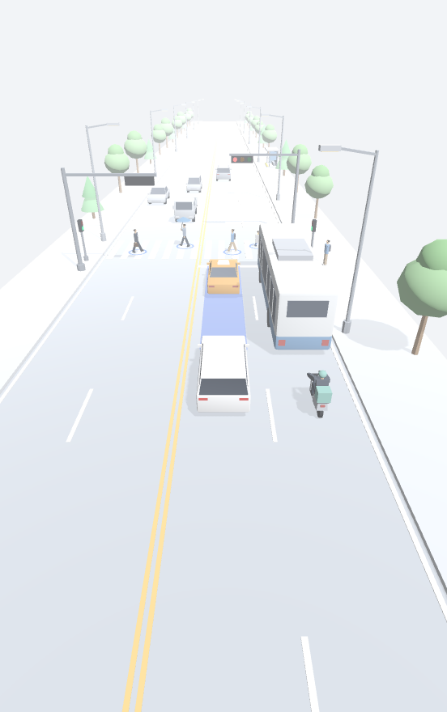
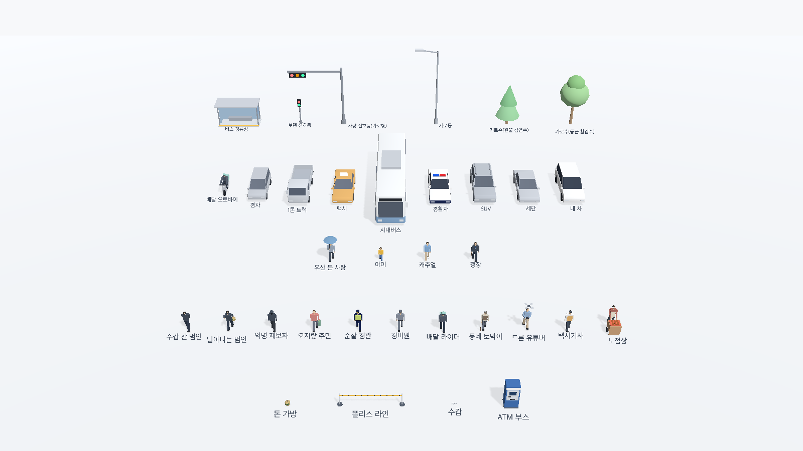
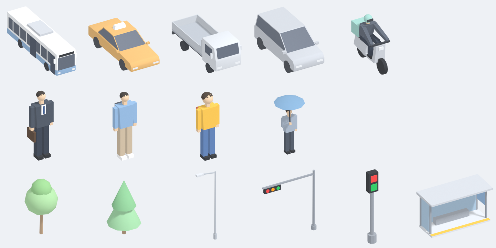
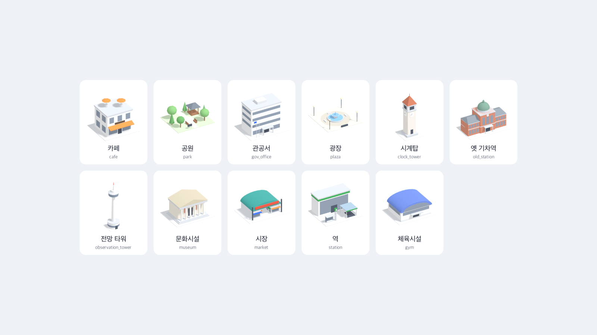
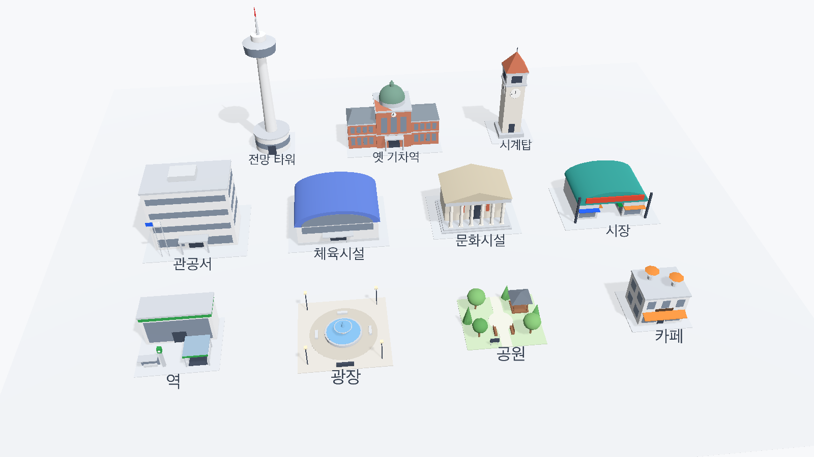
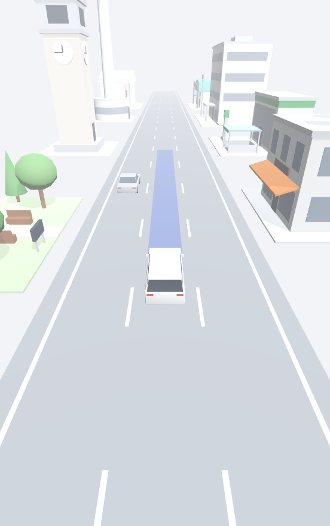
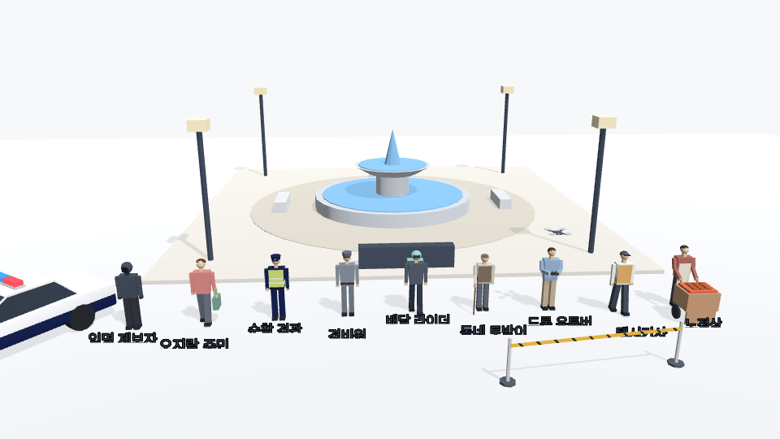
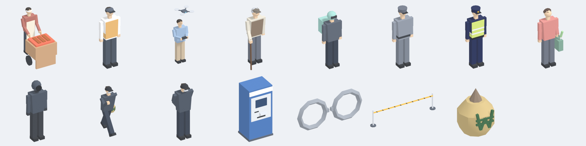
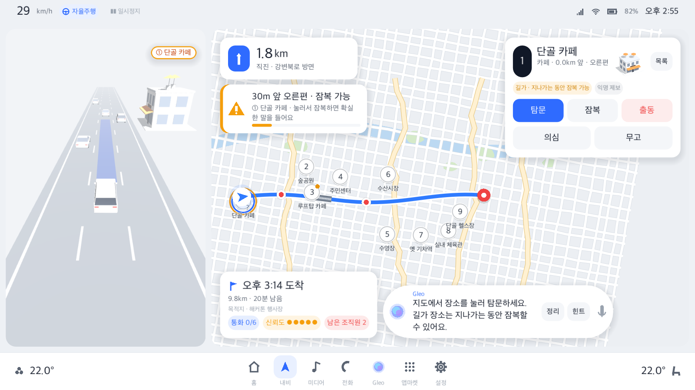

# 3D 에셋 (Blender 절차 생성)

Blender 파이썬 스크립트로 모델을 처음부터 만들어 `godot/assets/models/`로 내보낸다. 손으로 고친 .blend 파일은 없다.

| 스크립트 | 만드는 것 |
|---|---|
| [make_cars.py](make_cars.py) | 차량 9종(내 차, 세단, SUV, 경찰차, 시내버스, 택시, 1톤 트럭, 경차, 배달 오토바이) + 썸네일 + `vehicles.json` |
| [make_people.py](make_people.py) | 보행자 4종(정장, 캐주얼, 아이, 우산 든 사람) + 썸네일 + `people/people.json` |
| [make_props.py](make_props.py) | 길거리 소품 6종(가로수 2종, 가로등, 차량 신호등, 보행 신호등, 버스 정류장) + 썸네일 + `props/props.json` |
| [make_landmarks.py](make_landmarks.py) | 사건 장소용 랜드마크 11종 + 썸네일 + `landmarks/landmarks.json` |
| [make_figures.py](make_figures.py) | 현장 확대도용 인물 11종(제보자 9, 범인 2) + 소품 4종 + 썸네일 + `figures/figures.json` |
| [meshkit.py](meshkit.py) | 모든 스크립트가 함께 쓰는 도우미(머티리얼, 도형 쌓기, glb 내보내기, 썸네일, 목록 JSON) |



## 다시 만들기
Blender 5.2와 Godot 4.7이 필요하다. Blender가 없으면 `brew install --cask blender`로 설치한다.

저장소 루트에서 실행한다.
```bash
blender --background --factory-startup --python tools/blender/make_cars.py
```
```bash
blender --background --factory-startup --python tools/blender/make_people.py
```
```bash
blender --background --factory-startup --python tools/blender/make_props.py
```
```bash
blender --background --factory-startup --python tools/blender/make_landmarks.py
```
```bash
blender --background --factory-startup --python tools/blender/make_figures.py
```
모델 몇 개만 만들려면 `--` 뒤에 이름(id)을 붙인다. 목록 JSON의 나머지 항목은 그대로 남는다. `--out <폴더>`로 내보낼 곳을 바꿀 수 있다.
```bash
blender --background --factory-startup --python tools/blender/make_landmarks.py -- cafe park
```
그다음 Godot에서 다시 import한다.
```bash
godot --headless --path godot --import
```

## 공통 규격
- 1 단위 = 1m. 원점은 바닥 중앙이다(높이 0). 기둥형 소품만 원점이 기둥 바닥이다(아래 소품 표의 `anchor`).
- 앞쪽(차의 앞, 사람의 얼굴, 건물 입구, 신호등 램프 면)은 Godot 기준 -Z다. Blender 안에서는 +Y로 만들고, glTF(+Y up) 변환을 거쳐 -Z가 된다.
- 텍스처는 없다. 머티리얼은 무광 단색(거칠기 0.85, 금속성 0)이다.
- 머티리얼 이름은 `<모델>_<부위>` 형식이다. 예: `ego_body`, `police_red`, `cafe_front`.
- 메시 노드는 기본으로 `Body` 하나다(머티리얼만 여러 개). 따로 움직이거나 켜는 부분만 노드를 나눈다(표의 노드 열).
- 목록 JSON은 `{"models": {id: {label, glb, thumb, tris, max_tris, size_m, nodes, anchor, front_material, ...}}}` 형식이다. `size_m`은 Godot 축(x 폭, y 높이, z 깊이)이다.

## 검사와 미리보기
차량·보행자·소품·현장 인물 목록 네 개의 모든 모델을 검사한다. 보는 것:
- 삼각형 상한, 바닥 높이 0, 원점(`anchor`)
- 정면이 -Z인지(`front_material` 위치로 판단), 필요한 노드, 목록의 크기·삼각형 수, 썸네일 256px
- 보행자는 다리 노드 축이 엉덩이 높이인지, 다리가 바닥까지 닿는지, `LegL`이 왼쪽(-X)인지
- 다리가 곧은 인물은 정면 표시가 엉덩이 축보다 앞(-Z)인지 본다(손수레·드론처럼 앞에 든 물건이 모델 가운데를 앞으로 끌기 때문)

실패하면 종료 코드가 1이다.
```bash
godot --headless --path godot res://tests/model_preview.tscn -- --check
```
미리보기 스크린샷을 찍는다(창이 잠깐 뜬다). `--view`는 아래 중 하나다.
- `chase`(차 4종 뒤 위, 기본), `front`(앞), `adas`(차선 위 배치)
- `lineup`(모든 에셋을 줄 세움)
- `street`(자율주행 패널 크기 552×880로 교차로 장면)
- `scene`(현장 확대도 960×540: 광장 앞 제보자 9종, 경찰차, 폴리스 라인)
```bash
godot --path godot res://tests/model_preview.tscn -- --view=street --screenshot=$PWD/tools/blender/preview_assets_street.png
```




## 차량 9종 (`godot/assets/models/`, `vehicles.json`)
| 파일 | 모습 | 크기 (폭×높이×길이, 미러 포함) | 삼각형 | 노드 |
|---|---|---|---|---|
| `ego_car.glb` | 내 차. 흰색 박스형 크로스오버/MPV, 어두운 창 띠 | 2.16 × 1.74 × 4.72 m | 486 | `Body` |
| `traffic_sedan.glb` | 주변 차. 밝은 회색 세단 | 2.08 × 1.44 × 4.67 m | 514 | `Body` |
| `traffic_suv.glb` | 주변 차. 밝은 회색 SUV, 루프레일 | 2.18 × 1.78 × 4.77 m | 510 | `Body` |
| `police_car.glb` | 경찰차. 흰 차체 + 남색 아랫단 + 지붕 경광등 | 2.12 × 1.61 × 4.87 m | 610 | `Body`, `LightBarRed`, `LightBarBlue` |
| `bus.glb` | 시내버스. 흰 차체 + 은은한 파랑 아랫단, 옆 유리 띠, 오른쪽(+X) 앞·가운데 문, 지붕 냉방기 | 2.90 × 3.35 × 11.05 m | 628 | `Body` |
| `taxi.glb` | 택시. 은은한 황토색 세단 + 지붕 표시등 | 2.08 × 1.66 × 4.72 m | 526 | `Body`, `TaxiSign` |
| `truck.glb` | 1톤 트럭. 캡오버 운전석 + 낮은 짐칸 | 2.06 × 1.98 × 5.12 m | 536 | `Body` |
| `compact.glb` | 경차(해치백) | 1.86 × 1.52 × 3.62 m | 486 | `Body` |
| `scooter.glb` | 배달 오토바이 + 헬멧 쓴 운전자 + 민트색 배달 상자 | 0.72 × 1.74 × 1.86 m | 460 | `Body` |

- 처음 4종은 삼각형 2천 개, 추가 5종은 1,200개가 상한이다.
- 경광등은 운전석 쪽(-X)이 빨강, 조수석 쪽(+X)이 파랑이다. 받침은 `Body`에 들어 있다.
- `TaxiSign`은 흰 표시등이다. 켜려면 발광을 켠다(아래 '램프 켜기').
- 색과 치수는 `make_cars.py`의 `PALETTE`와 `make_*` 함수에서 바꾼다.

## 보행자 4종 (`godot/assets/models/people/`, `people.json`)
| 파일 | 모습 | 크기 (폭×높이×깊이) | 삼각형 |
|---|---|---|---|
| `ped_suit.glb` | 짙은 회색 정장, 흰 셔츠와 넥타이, 서류 가방 | 0.60 × 1.73 × 0.32 m | 316 |
| `ped_casual.glb` | 하늘색 후드, 베이지 바지, 흰 운동화, 배낭 | 0.60 × 1.73 × 0.37 m | 292 |
| `ped_kid.glb` | 아이(키 1.2m), 노란 윗옷, 청바지, 책가방 | 0.41 × 1.21 × 0.27 m | 292 |
| `ped_umbrella.glb` | 회색 비옷, 오른손으로 든 파란 우산 | 1.10 × 2.24 × 1.05 m | 354 |

- 노드: `Body`(몸통, 팔, 머리, 소지품), `LegL`, `LegR`. 삼각형 상한은 400개다.
- 다리 노드의 원점은 엉덩이 높이(`hip_m`: 어른 0.90m, 아이 0.61m)다. `rotation.x`를 앞뒤로 흔들면 걷는다.
- `LegL`은 사람 기준 왼쪽(-X)이다. 정면(얼굴, 발끝)은 -Z다.

## 길거리 소품 6종 (`godot/assets/models/props/`, `props.json`)
| 파일 | 모습 | 크기 (폭×높이×깊이) | 삼각형 | 노드 | 원점 |
|---|---|---|---|---|---|
| `tree_round.glb` | 둥근 활엽수, 연한 초록 | 2.85 × 5.40 × 3.00 m | 180 | `Body` | 바닥 중앙 |
| `tree_cone.glb` | 원뿔 침엽수 2단, 연한 초록 | 2.50 × 4.40 × 2.38 m | 56 | `Body` | 바닥 중앙 |
| `street_light.glb` | 가로등. 팔이 +X로 1.7m, 아랫면이 램프(`street_light_lamp`) | 2.45 × 8.18 × 0.40 m | 92 | `Body` | 기둥 바닥 |
| `traffic_light_car.glb` | 차량 신호등(가로형). 팔이 +X로 5.4m, 3색 가로 신호기 | 5.64 × 6.20 × 0.50 m | 228 | `Body`, `LampRed`, `LampYellow`, `LampGreen` | 기둥 바닥 |
| `traffic_light_ped.glb` | 보행 신호등. 위 빨강, 아래 초록 | 0.36 × 2.75 × 0.32 m | 92 | `Body`, `LampRed`, `LampGreen` | 바닥 중앙 |
| `bus_stop.glb` | 버스 정류장. 뒤·옆 유리, 의자, 노선 안내판, 앞쪽 노란 점자 블록 | 4.40 × 2.48 × 1.90 m | 132 | `Body` | 바닥 중앙 |

- 가로수는 메시가 하나라 MultiMesh에 바로 쓸 수 있다(줄기·잎은 같은 메시의 서로 다른 표면).
- 차량 신호등은 다가오는 차에서 보면 왼쪽(팔 끝)부터 빨강, 노랑, 초록이다(한국 가로형 3색).

## 랜드마크 11종
퍼즐 팩 장소의 업종 8가지에 하나씩, '랜드마크' 업종은 이름별로 3종을 만든다. 결과는 `godot/assets/models/landmarks/`에 있다.
- `<id>.glb`: 모델. 얇은 부지 판(높이 0.12m) 위에 건물이 선다. 삼각형은 모델당 1,500개 이하다.
- `thumbs/<id>.png`: 256×256 투명 배경 썸네일이다. 앞 오른쪽 위(방위 30°, 고도 30°)에서 본 직교 투영이다.
- `landmarks.json`: 장소 이름·업종 → 모델 id, 파일 경로, 크기(`size_m` = Godot 축 x 폭, y 높이, z 깊이), 삼각형 수.



| id | 쓰는 장소 | 모습 | 크기 (폭×높이×깊이) | 삼각형 |
|---|---|---|---|---|
| `cafe` | 카페 | 2층 상가, 주황 차양, 루프탑 파라솔 | 11 × 9.4 × 10 m | 352 |
| `park` | 공원 | 잔디, 산책로, 나무 6그루, 정자, 벤치 | 14 × 4.8 × 12 m | 648 |
| `gov_office` | 관공서 | 4층 띠창 건물, 현관 지붕, 깃대 | 20 × 15.5 × 16 m | 328 |
| `plaza` | 광장 | 2단 분수, 원형 바닥, 가로등 4개 | 16 × 4.7 × 16 m | 678 |
| `clock_tower` | 시계탑 (+ 이름 모를 랜드마크) | 네 면 시계, 뾰족지붕 | 10 × 22.1 × 10 m | 492 |
| `old_station` | 옛 기차역 | 붉은 벽돌 본관, 초록 돔, 양쪽 날개 | 22 × 15.6 × 14 m | 774 |
| `observation_tower` | 전망 타워 | 가는 기둥, 전망대, 빨간 끝 안테나 | 10 × 34.1 × 10 m | 556 |
| `museum` | 문화시설 | 열주 6개, 박공 지붕, 현수막 | 18 × 9.7 × 14 m | 464 |
| `market` | 시장 | 청록 아치 아케이드, 빨간 간판 문, 차양 | 20 × 7.3 × 14 m | 360 |
| `station` | 역 | 초록 띠 역사, 지하철 출입구 지붕, 역 번호 기둥 | 14 × 7.0 × 12 m | 296 |
| `gym` | 체육시설 | 파란 아치 지붕, 정면 아치 유리 | 20 × 8.5 × 16 m | 220 |

검사: 위 규격, 정면(`<id>_front` 머티리얼)이 -Z 쪽인지, JSON 크기와 썸네일, 그리고 퍼즐 팩(`godot/data/puzzles`)의 모든 장소가 모델을 찾는지 본다.
```bash
godot --headless --path godot res://tests/landmark_preview.tscn -- --check
```
미리보기 스크린샷: `--view`는 `grid`(격자, 기본), `road`(자율주행 패널 크기 552×880로 길가 배치), `thumbs`(썸네일 카드) 중 하나다.
```bash
godot --path godot res://tests/landmark_preview.tscn -- --view=road --screenshot=$PWD/tools/blender/preview_landmarks_road.png
```

| 격자 (`grid`) | 길가 (`road`) |
|---|---|
|  |  |

## 현장 확대도 인물·소품 15종 (`godot/assets/models/figures/`, `figures.json`)
메인 세션의 현장 3D 확대도(`scene_inset.gd`)에 쓴다. 목록 키는 역할 이름(VENDOR …)과 소품 이름(atm …)이고, 파일과 머티리얼 이름은 소문자다(`vendor.glb`, `vendor_shoe`). 항목의 `kind`는 `figure` 또는 `prop`이다.



| id | 파일 | 모습 | 크기 (폭×높이×깊이) | 삼각형 | 노드 |
|---|---|---|---|---|---|
| `VENDOR` | `vendor.glb` | 노점상 — 앞치마, 머리 수건, 앞에 작은 손수레(떡볶이 판) | 0.96 × 1.73 × 1.32 m | 528/600 | `Body`, `LegL`, `LegR` |
| `TAXI` | `taxi.glb` | 택시기사 — 흰 셔츠, 택시색 조끼, 납작한 모자 | 0.60 × 1.73 × 0.30 m | 408/600 | `Body`, `LegL`, `LegR` |
| `DRONE` | `drone.glb` | 드론 유튜버 — 후드, 두 손에 조종기, 머리 위 앞쪽에 떠 있는 드론 | 0.60 × 2.29 × 0.75 m | 520/600 | `Body`, `LegL`, `LegR`, `Drone` |
| `LOCAL` | `local.glb` | 동네 토박이 — 어르신(키 1.6m), 살짝 굽은 등, 흰머리, 니트 조끼, 납작 모자, 지팡이 | 0.58 × 1.61 × 0.46 m | 372/600 | `Body`, `LegL`, `LegR` |
| `RIDER` | `rider.glb` | 배달 라이더 — 민트 헬멧, 짙은 재킷, 등에 민트 배달 가방(scooter와 같은 색) | 0.60 × 1.75 × 0.55 m | 328/600 | `Body`, `LegL`, `LegR` |
| `GUARD` | `guard.glb` | 경비원 — 회색 제복, 챙 모자, 허리띠 | 0.60 × 1.74 × 0.31 m | 368/600 | `Body`, `LegL`, `LegR` |
| `COP` | `cop.glb` | 순찰 경관 — 남색 제복(경찰차 남색), 경찰 모자와 금색 모표, 형광 조끼 | 0.60 × 1.74 × 0.31 m | 416/600 | `Body`, `LegL`, `LegR` |
| `GOSSIP` | `gossip.glb` | 오지랖 주민 — 파마머리, 분홍 윗옷, 왼손 장바구니(대파) | 0.68 × 1.75 × 0.35 m | 424/600 | `Body`, `LegL`, `LegR` |
| `ANON` | `anon.glb` | 익명 제보자 — 후드를 깊게 쓴 어두운 실루엣, 얼굴 자리는 더 어두운 단색 | 0.60 × 1.76 × 0.30 m | 268/400 | `Body`, `LegL`, `LegR` |
| `CULPRIT_RUN` | `culprit_run.glb` | 달아나는 범인 — 모자와 마스크, 앞으로 기운 뛰는 자세, 왼손 돈 가방 (결말 전용) | 0.71 × 1.71 × 1.09 m | 488/500 | `Body`, `LegL`, `LegR` |
| `CULPRIT_CUFFED` | `culprit_cuffed.glb` | 수갑 찬 범인 — 모자와 마스크, 고개 숙임, 등 뒤로 모은 손에 수갑 (결말 전용) | 0.60 × 1.69 × 0.50 m | 362/500 | `Body`, `LegL`, `LegR` |
| `atm` | `atm.glb` | ATM 부스 — 은행 파랑 부스, 화면, 키패드, 카드·지폐 투입구 | 0.94 × 1.95 × 0.84 m | 92/300 | `Body` |
| `handcuffs` | `handcuffs.glb` | 수갑 — 선 고리 두 개 + 사슬. 실제 크기라 머리 위 아이콘으로는 2~3배 키운다 | 0.32 × 0.15 × 0.02 m | 184/300 | `Body` |
| `police_tape` | `police_tape.glb` | 폴리스 라인 — 기둥 2개(4m) + 노란 띠(앞면 검은 사선) | 4.36 × 1.05 × 0.36 m | 228/300 | `Body` |
| `money_bag` | `money_bag.glb` | 돈 가방 — 불룩한 자루, 앞면 ₩ | 0.34 × 0.44 × 0.34 m | 162/300 | `Body` |

- 서 있는 인물(CULPRIT_RUN 제외)은 다리 노드 원점이 엉덩이 높이다(`hip_m`: 어른 0.9m, LOCAL 0.84m). `rotation.x`로 흔든다. 값이 +이면 발이 앞(-Z)으로 간다.
- CULPRIT_RUN은 다리 노드에 뛰는 자세 회전이 들어 있다: `LegL` -25°(뒤), `LegR` +35°(앞). 메시는 곧고 노드 회전만 있으니, 흔들려면 그 값을 기준으로 더하거나 뺀다.
- DRONE의 `Drone` 노드는 원점이 드론 가운데(높이 약 2.2m)다. 위아래로 띄우거나 돌리면 된다.
- 원점은 모델 전체(손수레, 드론, 가방 포함)의 바닥 가운데다.
- 누설 금지: 제보자 9종은 '자칭 직업' 모습만 했다. 범인 2종(모자+마스크)은 결말 전용이다.



## Godot에서 쓰는 법
- 불러오기: `preload("res://assets/models/bus.glb").instantiate()`. 목록 JSON에서 경로와 크기를 읽어도 된다.
- 방향 맞추기 (내 차는 -Z로 달린다):
  - 반대 차로의 차: `rotation_degrees.y = 180`
  - 도로 오른쪽 가장자리의 가로등·차량 신호등: `180`. 팔이 도로 위(-X)로 뻗고 램프가 다가오는 차를 본다. 왼쪽 가장자리는 `0`.
  - 보행 신호등: 길 건너편을 보게 오른쪽 보도는 `90`, 왼쪽 보도는 `-90`.
  - 버스 정류장·랜드마크: 열린 쪽(정면)이 도로를 보게 오른편 `90`, 왼편 `-90`.
  - 횡단보도를 건너는 보행자: -X 방향으로 걸으면 `90`, +X 방향이면 `-90`.
- 램프 켜기(신호등, 택시 표시등): 노드의 머티리얼을 복제해 `material_override`로 붙이고 `emission_enabled`를 켠다. 끌 때는 알베도를 어둡게 한다. 예는 [model_preview.gd](../../godot/tests/model_preview.gd)의 `_set_lamp()`에 있다.
- 걷기: `LegL.rotation.x = sin(t) * 0.35`, `LegR.rotation.x = -sin(t) * 0.35` 식으로 흔든다. 예는 `_stride()`에 있다. 보행자 인식 링 예는 `_build_street()`에 있다.
- 장소에 맞는 랜드마크 찾기: [landmarks.gd](../../godot/scripts/case/landmarks.gd)의 `Landmarks`를 쓴다. 장소 이름을 먼저 보고, 없으면 업종을 본다.
  ```gdscript
  var tex := Landmarks.thumb(place["name"], place["kind"])      # 썸네일 (없으면 null)
  var id := Landmarks.id_for(place["name"], place["kind"])      # 모델 id (없으면 "")
  var node := Landmarks.instantiate(id)                         # 3D 모델
  ```
- 길가에 세우기: 정면(-Z)이 도로를 보게 돌린다. 도로 오른편이면 `rotation_degrees.y = 90`, 왼편이면 `-90`이다. 부지 깊이(`size_m[2]`)의 절반만큼 도로 가장자리에서 띄운다.
- 데모에 연결된 곳:
  - **자율주행 패널:** [roadside_landmarks.gd](../../godot/scripts/drive/roadside_landmarks.gd)가 사건 장소 중 길가 장소를 230m 앞부터 도로 옆에 세운다. 건물 위에는 번호 표지가 뜨고, 잠복 찬스 중인 곳은 주황 테두리로 강조된다. 사건을 수락하면 `CaseDirector`가 채운다.
  - **장소 카드:** 제목 오른쪽에 썸네일이 있다.
  - **오른쪽 장소 목록:** 아이콘 대신 썸네일이 나오고, 지나온 곳은 흐리게 보인다.


- 경광등 깜빡임: [model_preview.gd](../../godot/tests/model_preview.gd)의 `_setup_flash()` / `_set_bar_lit()`에 예가 있다.
  - `LightBarRed`, `LightBarBlue`는 `find_child()`로 찾는다.
  - 머티리얼을 복제해 `material_override`로 붙이고 `emission_enabled`를 켠다.
  - 켤 때는 `emission_energy_multiplier`를 올리고, 끌 때는 0으로 두고 알베도를 어둡게 한다.
- 조명: Compatibility 렌더러에서는 빛이 생각보다 세다. 미리보기 씬들은 아래 값으로 Pleos 밝은 화면과 비슷하게 맞췄다. 이보다 세면 흰 차와 건물, 도로가 하얗게 날아간다.
  - 배경: 단색 `#F7F8FA`
  - 주변광: Color, 흰색, 에너지 0.25
  - 반사광: 끔
  - DirectionalLight3D: 에너지 0.25, 그림자 불투명도 0.35
